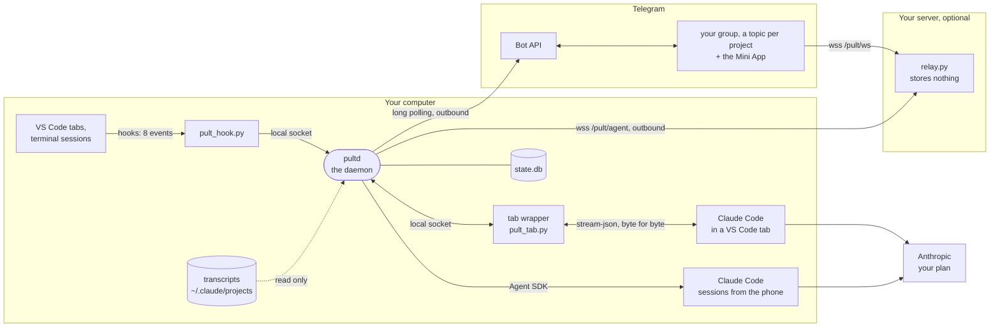
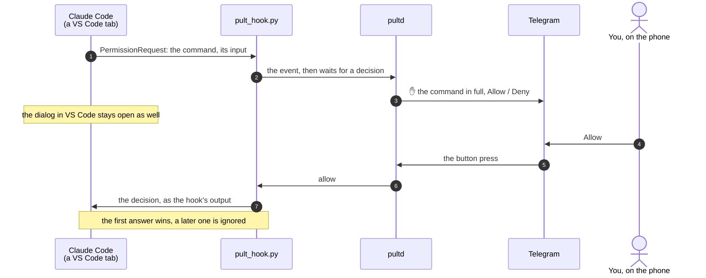
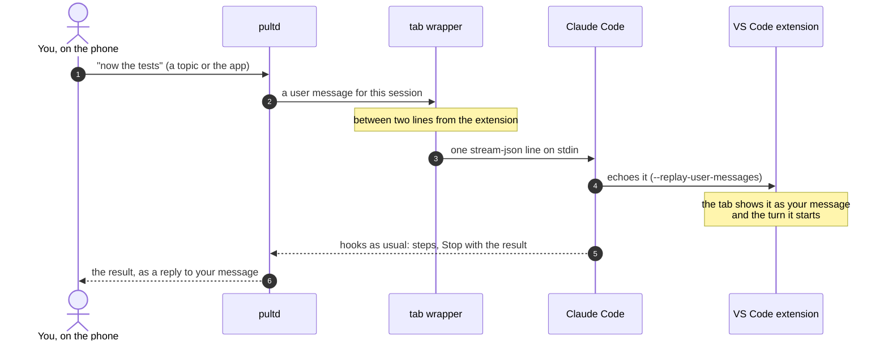
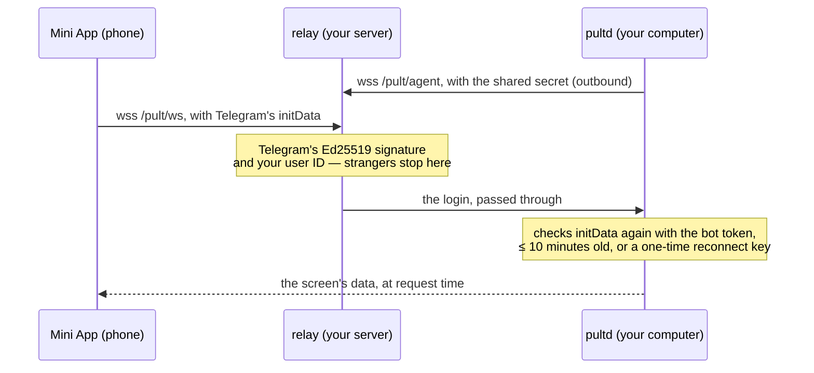
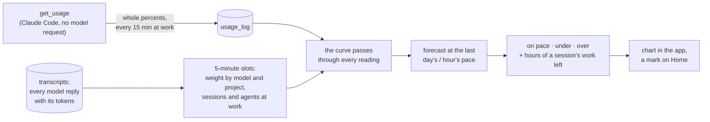

# How Pult works

[Русский](ARCHITECTURE.ru.md) · back to the [README](README.md)

Pult is one small daemon on your computer, **next to** Claude Code rather than in front of it. It hears every session
through Claude Code's hooks, starts sessions of its own through the Agent SDK, and, optionally, writes into open
VS Code tabs through a process wrapper. Outward it talks only to Telegram's Bot API and to an optional relay on
your own server, and both of those connections go out from the computer. **Nothing on the computer listens on the
network.**

## The big picture

| Part | What it is | Why it's built this way |
|---|---|---|
| **pultd** | a Python asyncio daemon: launchd on macOS, a systemd user service on Linux, a logon task on Windows | one owner, one place that holds the state and the bot token |
| **pult_hook.py** | the command Claude Code runs on `SessionStart`, `UserPromptSubmit`, `PostToolUse`, `PostToolUseFailure`, `Stop`, `StopFailure`, `SessionEnd` and `PermissionRequest`; standard library only. A unix socket, or on Windows 127.0.0.1 with a key in a file only you can read | it runs inside *every* session on the computer, so it must be tiny and can never fail loudly |
| **pult_tab.py** | an optional `claudeCode.claudeProcessWrapper` between the VS Code extension and Claude Code | the only way to put a message into a tab that is already open |
| **Agent SDK** | sessions started from Telegram or the app run your own Claude Code in the project's folder, by default in its `auto` permission mode (`PULT_PERMISSION_MODE`) | same settings, same system prompt, same plan as a terminal |
| **relay.py** | a WebSocket relay on a small Linux server (~50 MB of memory) | Telegram opens Mini Apps only from public HTTPS; the computer stays closed |
| **Mini App** | Preact + htm, no build step, served by the relay | a full screen on the phone: transcripts, answers, new tasks, usage |

## A permission request, answered from the phone

The hook and the dialog in VS Code race each other. Claude Code takes the first answer and ignores a later one,
so you can answer in either place and nothing gets stuck.

If the daemon is down, the hook exits at once with no output, and Claude Code shows its own dialog as if Pult
weren't there.

## A message from the phone into an open VS Code tab

The wrapper passes everything else through byte for byte. It acts only on Claude Code versions it was checked on,
and only in the folders you chose. In every other case (an off switch, an unknown version, any error before the
start) it simply runs the real `claude` in its own place and is gone. A tab busy with a turn gets your message in
the middle of that turn: the tab doesn't show it as a separate message, and the answer comes with that turn's result.

## The web app: a relay that stores nothing

The relay keeps no data: every screen comes from the computer when you open it. The page loads scripts only from
your server and Telegram (Content-Security-Policy), and the computer compares the files the server hands out with
what was deployed — or with the release the server took itself — closing the app if they differ (`PULT_GUARD=warn`:
only a warning, for a CDN that changes files).

## Usage pace: how the curve is computed

The Resources screen shows each limit (the week, the 5-hour window) from its start to its reset, against the even
pace, with a forecast at your current pace and how many sessions worked at once.

- **The percent is the truth.** It comes from Claude Code's own `get_usage` request: about two seconds, no model
  request. Each reading is kept for 60 days.
- **The shape between two readings comes from the transcripts.** A reply weighs
  `input + R·cache read + 1.25·cache write (2 for the 1-hour cache) + 5·output` — the API's price ratios, R being its
  model's own: 0.05 for Opus 5.5, 0.025 for Fable 5.1, 0.1 for the rest — times its model's factor. Fable's
  factor is fitted to the share of the week that Fable used, which `get_usage` reports; "On Fable it costs about N× as
  much" compares the same work: Fable's tokens against what they would weigh at Opus's read price. The growth between two
  readings is spread over the slots in proportion to weight, so the curve passes through every reading even if the
  plan weighs tokens differently. Growth with no tokens on this computer shows as "not on this computer".
- **A session is at work** from your message to the end of its turn (`end_turn`); inside a turn, a pause of up to
  30 minutes (a long command) still counts. Subagents are counted apart.
- **Cost:** the first pass over a week of transcripts takes about 2 s (1.15 GB measured); after that, only what was
  appended is read (~20 ms). The answer to the app is ~6 KB.

## What never breaks your Claude Code

| Rule | How |
|---|---|
| The hook never gets in the way | no daemon, a timeout, any error: exit 0 with no output |
| The wrapper never gets in the way | any doubt: run the real `claude` in its place; data passes byte for byte |
| A Claude Code update can't break tabs | writing into tabs turns itself off on an unchecked version, and Pult tells you |
| Answers don't get stuck | permission hook and dialog race; the first answer wins |
| A restart doesn't kill work | `pult restart` / `stop` / `install.sh` refuse while sessions from the phone are busy (`pult busy`) |
| The computer stays closed | Telegram: long polling; relay: an outbound WebSocket; no listening ports |
| Settings stay yours | the hooks go into `~/.claude/settings.json` with a backup; `pult hooks off` and `pult uninstall` undo it |
| A file goes back only from its project | `pult send` and "To Telegram" take files inside the session's project folder only (links followed), nothing like keys or settings, up to 50 MB; only to your group |
| A new project overwrites nothing | only a new folder inside your home folder; a taken one is refused, and so is a name Claude Code would mix up with another project's; a clone goes to git as an https link only |
| An update installs only what is committed | the app's Install takes Pult's own files from the commit checked out in its folder (or, in a clone of Pult's repository, from the newest release it fetched from GitHub), never uncommitted changes, and asks first if a restart would cut off sessions from the phone; a version that doesn't come up is replaced by the old one |
| The computer has no power over the server | the computer only names the release it runs; the server's updater takes that release from GitHub — an official one, never older than its own — under an account that owns the relay's code and nothing else, and switches back by itself when the relay doesn't come up (`deploy/relay/update.py`) |

## Code map

| File | Role |
|---|---|
| `src/pultd.py` | the daemon: events, sessions, Telegram, warnings |
| `src/pult_api.py` | what the app's screens ask — Home, projects, a session, a new project, files, voice, spend, settings: the handlers of their requests, a part of the daemon itself (a mixin of its class), reading the daemon's own settings through the daemon |
| `src/pult_parts.py` | Pult's parts and its updates — the Settings screen "Pult and its parts" and what keeps Pult current: an update installed from the app, the relay's server following this computer, releases on GitHub, every part against what is installed, the check of a Claude Code version VS Code has downloaded; a mixin of the daemon's class, like `pult_api` |
| `src/pult_driven.py` | the sessions Pult runs itself through the Agent SDK — new, continued or a copy, their place among the turns that run at once, the hooks put into them — and what Pult keeps of every live session |
| `src/pult_tg.py` | the daemon's line to Telegram — the Bot API client (through the proxy first, directly when that fails) and the queue every message goes through within Telegram's limits — and its state database |
| `src/pult_hook.py` | the hook: an event to the daemon, a decision back; standard library only |
| `src/pult_tab.py`, `src/pult-tab.sh` | the tab wrapper and its launcher |
| `src/pult_tabcheck.py` | checks a Claude Code version VS Code has downloaded, on your computer, before a window reloads onto it: the wrapper, a message from the phone, the model, the effort and the permission race on the new version's own `claude` (`pult tab check`) |
| `src/pult_codex.py` | a second opinion from Codex: finds Codex and checks its version against its own protocol schema, gathers what the task was (your words, Claude's report, the files, the commit it began on), runs one read-only review over Codex's `app-server` protocol and reads its findings |
| `src/pult_vendors.py` | other vendors' models inside Claude Code: each vendor's profile (address, models by role, compaction window, advice, price), a session's environment — never without the owner's key — and the key's check |
| `src/pult_web.py` | the connection to the relay, login checks, transcripts for the app |
| `src/pult_render.py`, `src/pult_i18n.py` | what messages look like; every visible string in English and Russian |
| `src/pult_attn.py`, `src/pult_brief.py` | "whose move": each session's outcome; an optional one-line summary by a small model |
| `src/pult_tags.py` | task tags: each task's section of the project and topic in it, kept by the same small model from the request, Claude's reply and the files it worked with; the owner only corrects |
| `src/pult_spend.py` | usage pace: transcripts in slots, the curve, the forecast |
| `src/pult_load.py` | the load each session puts on the computer, from one process snapshot |
| `src/pult_new.py` | a new project: the folder's name from any title, the checks, the clone link |
| `src/pult_files.py` | files to and from the phone: names, the project's inbox, what may be sent, the turn's files, archives |
| `src/pult_update.py` | an update from the app: what in the folder is newer (in a clone of Pult's repository, the releases on GitHub), the installer with its rollback, the history; how far each part (the relay server's copy by its files) is behind the branch |
| `src/pult_os.py` | everything that differs between macOS, Linux and Windows |
| `src/pult_stt.py` | voice to text (Groq Whisper, your key) |
| `src/pultctl.py`, `src/pult_setup.py` | the `pult` command; install, the setup wizard, the report, uninstall |
| `relay/relay.py`, `relay/web/` | the relay and the Mini App (Preact + htm, no build step) |
| `deploy/relay/` | the relay on your server: `install.sh`, its systemd units, `update.py` — the updater that takes the computer's release from GitHub |

## Where things live

| What | Where |
|---|---|
| code and its Python environment | `~/.local/share/pult/` (the installer copies it there) |
| state: topics, sessions, outcomes, the turns' files, usage readings | `~/.local/share/pult/state.db` (SQLite) |
| secrets: bot token, your ID, relay secret, voice key | `~/.config/pult/env`, mode 600 |
| hooks | `~/.claude/settings.json`, entries that name `pult_hook.py` |
| the tab wrapper | the VS Code setting `claudeCode.claudeProcessWrapper` (you add the line) |
| logs | `~/Library/Logs/pult.log` (macOS), `~/.local/state/pult/pult.log` (Linux, Windows) |

## Tests

- `tests/test_pult.py`, `test_setup.py`, `test_web.py`, `test_relay.py` run without Telegram or Claude: a fake Bot
  API, a real relay, made-up transcripts. GitHub Actions runs them on macOS, Ubuntu and Windows.
- `tests/e2e_live.py` drives a real Claude (haiku) through the whole chain; it uses a little of your plan.
- `tests/probe_*.py` re-check facts about Claude Code that Pult relies on (the hook-and-dialog race, the wrapper's
  stream, background tasks…). They are re-run after every Claude Code update, and writing into tabs is allowed on a
  new version only after they pass.
