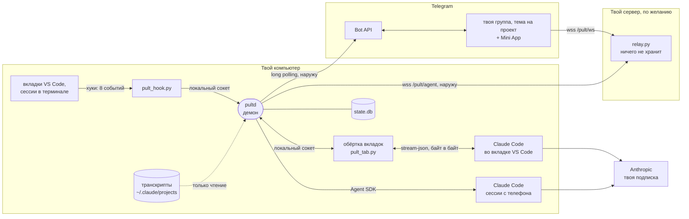
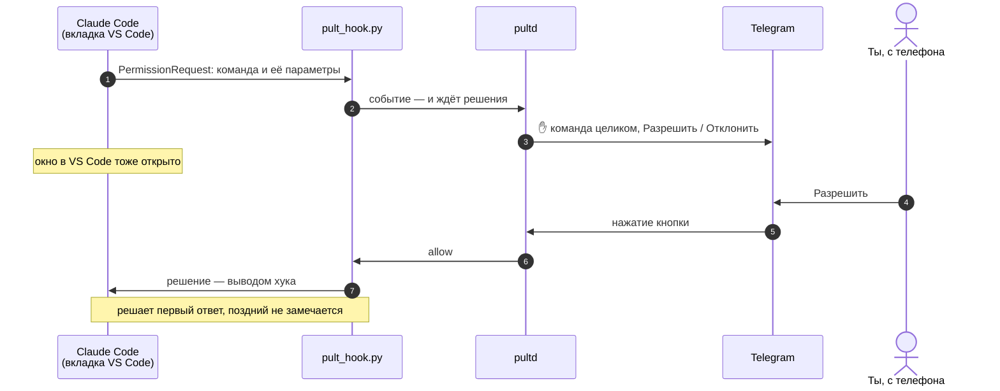
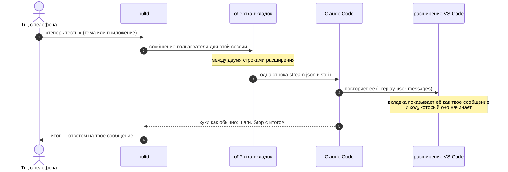
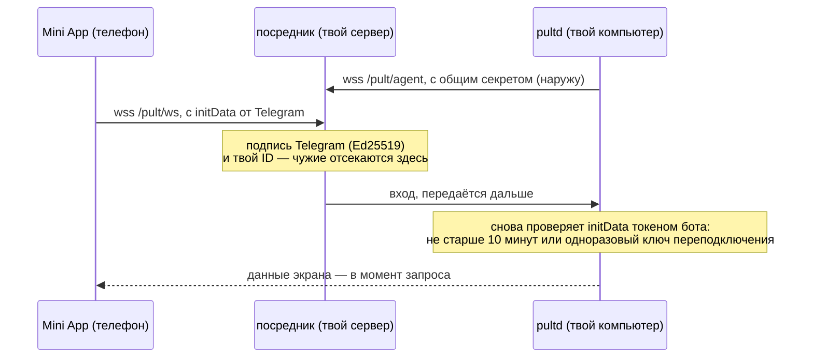
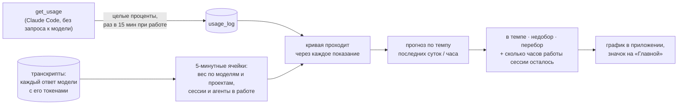

# Как устроен Пульт

[English](ARCHITECTURE.md) · назад к [README](README.ru.md)

Пульт — один небольшой демон на твоём компьютере, который стоит **рядом** с Claude Code, а не перед ним. Он слышит
каждую сессию через хуки Claude Code, запускает свои сессии через Agent SDK и по желанию пишет в открытые вкладки
VS Code через обёртку процесса. Наружу он говорит только с Bot API Telegram и с посредником на твоём сервере (по
желанию), и оба соединения идут с компьютера наружу. **На компьютере ничто не слушает сеть.**

## Общая схема

| Часть | Что это | Почему так |
|---|---|---|
| **pultd** | демон на Python asyncio: launchd на macOS, пользовательская служба systemd на Linux, задание при входе на Windows | один владелец, одно место, где лежат состояние и токен бота |
| **pult_hook.py** | команда, которую Claude Code запускает на `SessionStart`, `UserPromptSubmit`, `PostToolUse`, `PostToolUseFailure`, `Stop`, `StopFailure`, `SessionEnd` и `PermissionRequest`; только стандартная библиотека. Unix-сокет, а на Windows — 127.0.0.1 с ключом в файле, который читаешь только ты | он работает внутри *каждой* сессии на компьютере, поэтому должен быть крошечным и никогда не падать громко |
| **pult_tab.py** | обёртка `claudeCode.claudeProcessWrapper` (по желанию) между расширением VS Code и Claude Code | единственный способ положить сообщение в уже открытую вкладку |
| **Agent SDK** | сессии из Telegram и приложения — твой же Claude Code в папке проекта, по умолчанию в его режиме разрешений `auto` (`PULT_PERMISSION_MODE`) | те же настройки, тот же системный промпт, та же подписка, что в терминале |
| **relay.py** | посредник WebSocket на небольшом Linux-сервере (~50 МБ памяти) | Telegram открывает Mini App только с публичного HTTPS; компьютер остаётся закрытым |
| **Mini App** | Preact + htm, без сборки, раздаётся посредником | полный экран на телефоне: переписка, ответы, новые задачи, расход |

## Запрос разрешения, отвеченный с телефона

Хук и окно в VS Code идут наперегонки. Claude Code берёт первый ответ и не замечает поздний, поэтому можно
ответить в любом месте, и ничего не зависнет.

Если демон не запущен, хук сразу выходит без вывода, и Claude Code показывает своё окно, будто Пульта нет.

## Сообщение с телефона в открытую вкладку VS Code

Всё остальное обёртка передаёт байт в байт. Она действует только на проверенных версиях Claude Code и только в
выбранных тобой папках. В любом другом случае (выключатель, незнакомая версия, любая ошибка до старта) она просто
запускает настоящий `claude` на своё место и исчезает. Вкладка, занятая ходом, получает сообщение посреди этого
хода: отдельным сообщением вкладка его не показывает, а ответ приходит с итогом того хода.

## Веб-приложение: посредник, который ничего не хранит

Посредник данных не хранит: каждый экран приходит с компьютера, когда ты его открываешь. Страница загружает скрипты
только с твоего сервера и Telegram (Content-Security-Policy), а компьютер сверяет файлы, которые отдаёт сервер, с
выложенными и закрывает приложение при расхождении.

## Темп расхода: как считается кривая

Экран «Ресурсы» показывает каждый лимит (неделю, окно 5 ч) от начала до сброса — против ровного темпа, с прогнозом
при нынешнем темпе и с тем, сколько сессий работало одновременно.

- **Процент — правда.** Он приходит из собственного запроса Claude Code `get_usage`: около двух секунд, без
  запроса к модели. Каждое показание хранится 60 дней.
- **Форма между двумя показаниями — по транскриптам.** Ответ весит
  `вход + 0,1·чтение кэша + 1,25·запись в кэш (2 для часового кэша) + 5·выход` — соотношения цен API — на множитель
  своей модели. Множитель Fable подбирается по доле недели, которую потратил Fable: её сообщает `get_usage`.
  Прирост между двумя показаниями раскладывается по ячейкам пропорционально весу, поэтому кривая проходит через
  каждое показание, даже если подписка взвешивает токены иначе. Прирост без токенов на этом компьютере виден как
  «не на этом компьютере».
- **Сессия в работе** — от твоего сообщения до конца её хода (`end_turn`); пауза внутри хода до 30 минут (долгая
  команда) тоже считается работой. Агенты считаются отдельно.
- **Цена:** первое чтение недели транскриптов — около 2 с (замер — 1,15 ГБ); дальше читается только дописанное
  (~20 мс). Ответ приложению — ~6 КБ.

## Что никогда не ломает твой Claude Code

| Правило | Как |
|---|---|
| Хук никогда не мешает | нет демона, тайм-аут, любая ошибка — выход 0 без вывода |
| Обёртка никогда не мешает | при любом сомнении — настоящий `claude` на её место; данные идут байт в байт |
| Обновление Claude Code не сломает вкладки | на непроверенной версии запись во вкладки выключается сама, и Пульт говорит об этом |
| Ответы не зависают | хук разрешения и окно идут наперегонки; решает первый ответ |
| Перезапуск не убивает работу | `pult restart` / `stop` / `install.sh` отказывают, пока сессии с телефона заняты (`pult busy`) |
| Компьютер закрыт | Telegram — long polling; посредник — исходящий WebSocket; слушающих портов нет |
| Настройки остаются твоими | хуки ложатся в `~/.claude/settings.json` с резервной копией; `pult hooks off` и `pult uninstall` всё откатывают |
| Файл уходит только из своего проекта | `pult send` и «В Telegram» берут только файлы внутри папки проекта сессии (после разворота ссылок), ничего похожего на ключи и настройки, до 50 МБ; только в твою группу |
| Новый проект ничего не перезаписывает | только новая папка внутри домашней; занятую Пульт отклоняет, как и имя, которое Claude Code спутает с другим проектом; клон доходит до git только ссылкой https |
| Обновление ставит только закоммиченное | «Поставить» в приложении берёт файлы самого Пульта из коммита, на котором стоит его папка (а в клоне репозитория Пульта — из новейшего выпуска, скачанного с GitHub), — никогда незакоммиченные правки; если перезапуск оборвёт сессии с телефона, сначала спросит; новая версия не поднялась — вернётся прежняя |
| Компьютер не получает власти над сервером | компьютер только называет выпуск, на котором стоит; обновлятель на сервере берёт этот выпуск с GitHub — официальный и не старше своего — от учётки, которой принадлежит только код посредника, и сам возвращает прежний, если посредник не поднялся (`deploy/relay/update.py`) |

## Карта кода

| Файл | Роль |
|---|---|
| `src/pultd.py` | демон: события, сессии, Telegram, запросы приложения, предупреждения |
| `src/pult_hook.py` | хук: событие — демону, решение — обратно; только стандартная библиотека |
| `src/pult_tab.py`, `src/pult-tab.sh` | обёртка вкладок и её запуск |
| `src/pult_web.py` | связь с посредником, проверка входа, транскрипты для приложения |
| `src/pult_render.py`, `src/pult_i18n.py` | как выглядят сообщения; все видимые строки по-английски и по-русски |
| `src/pult_attn.py`, `src/pult_brief.py` | «чей ход»: итог каждой сессии; строка итога маленькой моделью (по желанию) |
| `src/pult_tags.py` | теги задач: раздел проекта и тема в нём у каждой задачи — ведёт та же маленькая модель по запросу, ответу Claude и файлам задачи; человек только поправляет |
| `src/pult_spend.py` | темп расхода: транскрипты в ячейках, кривая, прогноз |
| `src/pult_load.py` | нагрузка каждой сессии на компьютер по одному снимку процессов |
| `src/pult_new.py` | новый проект: имя папки из любого названия, проверки, ссылка для клона |
| `src/pult_files.py` | файлы с телефона и на телефон: имена, входящие проекта, что можно отправить, файлы хода, архивы |
| `src/pult_update.py` | обновление из приложения: что в папке новее (в клоне репозитория Пульта — выпуски на GitHub), установщик с откатом, история; насколько каждая часть (копия на сервере — по её файлам) отстаёт от ветки |
| `src/pult_os.py` | всё, что различается на macOS, Linux и Windows |
| `src/pult_stt.py` | голос в текст (Groq Whisper, твой ключ) |
| `src/pultctl.py`, `src/pult_setup.py` | команда `pult`; установка, мастер, отчёт, удаление |
| `relay/relay.py`, `relay/web/` | посредник и Mini App (Preact + htm, без сборки) |
| `deploy/relay/` | посредник на твоём сервере: `install.sh`, его службы systemd, `update.py` — обновлятель, который берёт выпуск компьютера с GitHub |

## Где что лежит

| Что | Где |
|---|---|
| код и его окружение Python | `~/.local/share/pult/` (туда копирует установщик) |
| состояние: темы, сессии, итоги, файлы ходов, показания расхода | `~/.local/share/pult/state.db` (SQLite) |
| секреты: токен бота, твой ID, секрет посредника, ключ голоса | `~/.config/pult/env`, права 600 |
| хуки | `~/.claude/settings.json`, записи с `pult_hook.py` |
| обёртка вкладок | настройка VS Code `claudeCode.claudeProcessWrapper` (строку добавляешь ты) |
| журналы | `~/Library/Logs/pult.log` (macOS), `~/.local/state/pult/pult.log` (Linux, Windows) |

## Проверки

- `tests/test_pult.py`, `test_setup.py`, `test_web.py`, `test_relay.py` идут без Telegram и Claude: поддельный
  Bot API, настоящий посредник, выдуманные транскрипты. GitHub Actions гоняет их на macOS, Ubuntu и Windows.
- `tests/e2e_live.py` ведёт настоящего Claude (haiku) через всю цепочку; тратит немного подписки.
- `tests/probe_*.py` перепроверяют факты о Claude Code, на которых держится Пульт (гонка хука и окна, поток
  обёртки, фоновые задачи…). Их перезапускают после каждого обновления Claude Code, и запись во вкладки на новой
  версии разрешается только после того, как они прошли.
