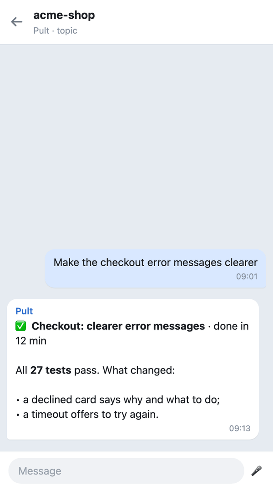
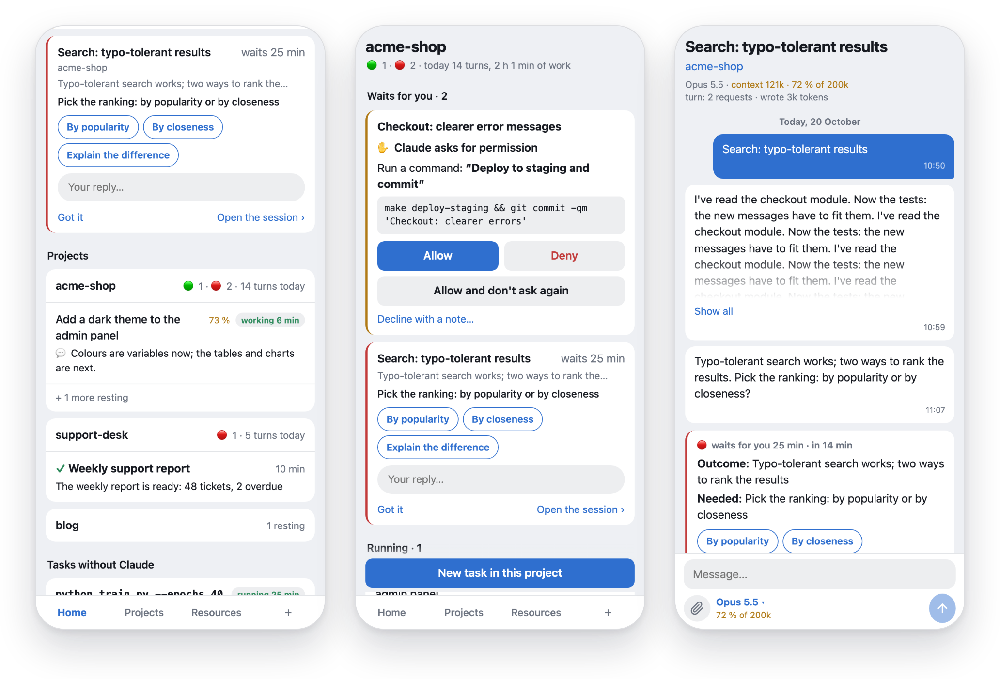
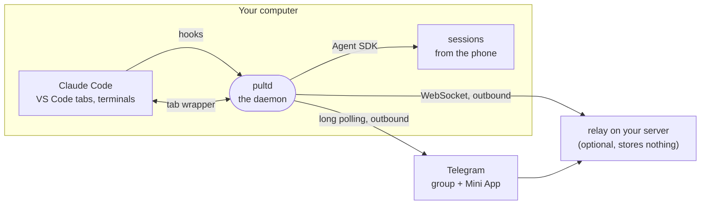

# Pult

**Watch and steer every Claude Code session on your computer — from Telegram.**

[](https://github.com/pulthq/pult/actions/workflows/tests.yml)
[](https://github.com/pulthq/pult/releases)
&nbsp;MIT · macOS, Linux and Windows · English and Russian · [Русский](README.ru.md)

<p align="center">
  
  &nbsp;
  
</p>
<p align="center"><sub>Left: a project's topic in Telegram. Right: Home in the web app. Made-up projects, drawn from Pult's own output on the test stand.</sub></p>

You give Claude Code a task and walk away. Claude stops to ask a question or wait for a permission, and the work
stalls until you're back. **Pult** puts every Claude Code session on your computer into a Telegram group, one
topic per project: your phone shows what Claude is doing, buzzes only when Claude needs you, and lets you answer,
continue or start a session — and what you do from the phone shows up in the open VS Code tab. It runs on your
computer and opens no port to the network.

```
git clone https://github.com/pulthq/pult.git && cd pult && ./install.sh
```

About ten minutes with your own Telegram bot; on Windows the installer is `install.ps1`. *Pult* is Russian for a
remote control.

## What you get

| | |
|---|---|
| **Every session, nothing to start** | VS Code tabs and terminal sessions appear in their project's topic through Claude Code's hooks, including the ones you opened before leaving. |
| **Answer from anywhere** | Permission requests and Claude's questions come with buttons. The dialog on the computer stays open too: whichever answer comes first decides. |
| **Write back, even into an open tab** | A reply continues that session, `/new` starts one. With the optional tab wrapper, your message appears in the VS Code tab as if typed there. Photos and files reach Claude too; voice messages turn into text with a free Groq key. |
| **Files both ways** | Forward documents, decks or pictures to a project's topic: they land in the project's `inbox/<date>/` under their own names, an album goes as one message, and files without words wait for your next one. Ask for a result and Claude sends it back to the topic with `pult send` — only files of that project, nothing that looks like a key. |
| **Pick the model and effort** | Fable, Opus, Sonnet or Haiku and how hard Claude thinks, for one session — a running one switches at once. |
| **See your plan's pace** | Each limit, the week and the 5-hour window, as a curve against the even pace, with a forecast: on pace, under (how many hours of a session's work would go unused) or over (when it runs out). Under it, how many sessions worked at once. |
| **Called only when it matters** | With the web app, Telegram becomes a pager: it rings when Claude waits for you and you're neither in the app nor at the computer. Reminders on long turns, warnings at 80 % and 95 % of a limit. |
| **Your own long commands** | `pult run -- npm run build` reports the start, the progress and the exit code the same way. |

## The web app (optional)

A Telegram Mini App on a small server of yours, one tap from any topic — the comfortable way to work from the
phone:

- **Home** is built around whose move it is: what runs right now, then what waits for you — permission requests to
  answer right there, sessions that ended and need you, with ready replies taken from Claude's own message.
- **A session** shows the whole conversation, live, with the model, the effort and the context gauge under the
  message field.
- **Resources** shows how you spend your plan: the curve of each limit, the forecast, who spent it, and the
  computer's load.
- **Files of the turn** under its outcome: what Claude made or changed in the project, each one a tap away from the
  project's topic in Telegram.
- **A new project** from the phone: a folder anywhere in your home folder — empty with git, with a `CLAUDE.md` that
  Claude writes from your description, or a clone of a repository. Its topic appears in the group at once.

<p align="center">
  
</p>
<p align="center">
  
</p>

It needs a Linux server with a domain and HTTPS: [deploy/relay/README.md](deploy/relay/README.md). Without it,
everything else works in the chat alone.

## How it works



- **Hooks** pass every session's events to the daemon. If the daemon isn't running, the hook exits quietly and
  Claude Code behaves as if Pult weren't there.
- **Permission requests** race the dialog on the computer: Claude Code takes the first answer and ignores a later
  one, so nothing gets stuck.
- **Sessions from the phone** are your own Claude Code through the Agent SDK: the project's folder, your settings,
  Claude Code's own system prompt.
- **Writing into an open tab** goes through an optional process wrapper that passes everything through byte for
  byte. It works only on Claude Code versions it was checked on; on a new version it turns itself off and tells
  you.
- **The usage curve** passes through Claude Code's own readings of your limits; its shape between them comes from
  the tokens in your transcripts.

The details, with diagrams of each path: **[ARCHITECTURE.md](ARCHITECTURE.md)**.

## How it differs from the official options

Anthropic has its own ways to reach Claude Code away from the keyboard. If they fit you, use them.

| | Pult | [Remote Control](https://code.claude.com/docs/en/remote-control) | [Channels](https://code.claude.com/docs/en/channels) |
|---|---|---|---|
| Where you answer | Telegram, plus an optional web app inside it | claude.ai/code or the Claude app | Telegram, Discord or iMessage |
| Which sessions | every VS Code tab and terminal session, picked up by hooks | the ones you connect, or all with its auto-connect setting | a session started with `claude --channels …` |
| Your sign-in | whatever Claude Code is signed in with | a claude.ai plan; API keys aren't supported | claude.ai or a Console API key |
| Status | independent, open source | official | official, research preview |

On top of reaching a session, Pult keeps one group with a topic per project and its history, knows where you are
before it rings, shows your plan's pace, and needs no Claude app, which isn't available in every country.

## Requirements

- macOS, Linux or Windows; tested on macOS 26 (Apple Silicon), Ubuntu 24.04 (arm64) and Windows 11 (x64).
- Claude Code, signed in: the VS Code extension, the CLI or both. Tested with the extension 2.1.301 (on Windows,
  2.1.306) and the Agent SDK 0.2.167.
- Python 3.10+: `brew install python@3.12`, `sudo apt install python3 python3-venv`, or on Windows
  [python.org](https://www.python.org/downloads/windows/) / `winget install Python.Python.3.12` (not the Microsoft
  Store one).
- Telegram and a bot of your own, created in @BotFather; the setup walks you through it.

## Install

```
git clone https://github.com/pulthq/pult.git
cd pult
./install.sh
```

The installer makes its own Python environment in `~/.local/share/pult`, puts the `pult` command into
`~/.local/bin` and adds a background service (launchd on macOS, a systemd user service on Linux). Then a wizard:

1. **Bot.** In @BotFather: `/newbot`, paste the token.
2. **You.** Open the link it shows on your phone and tap **Start**: Pult learns your ID and language.
3. **Group.** Create a group with **Topics** on, add the bot as an admin with **Manage Topics** and **Pin
   Messages**, send `/bind@your_bot` there. The wizard checks it and says what's missing.
4. **Hooks.** Pult adds its hooks to `~/.claude/settings.json`, keeping your other settings and a backup.

Then **Developer: Reload Window** in VS Code, so open tabs pick up the hooks. Optional: `pult tab setup` (writing
into open tabs: one line for the VS Code settings), `pult app` (the web app), `pult stt` (voice, a free Groq key).

<details>
<summary><b>On Linux</b></summary>

- **A desktop with VS Code or a terminal:** the same as on a Mac.
- **A server opened in VS Code through Remote-SSH:** Claude Code runs on the server, so install Pult there; the line
  from `pult tab setup` goes into the server's settings (**Preferences: Open Remote Settings (JSON)**).
- **Claude Code in a terminal over SSH:** sessions, permissions and questions come to Telegram the same way.
- A user's services stop when they log out: `sudo loginctl enable-linger $USER` keeps Pult running and starts it at
  boot (the installer reminds you).
- "Away from the computer" comes from GNOME, KDE or X11; elsewhere, from what you do in sessions.

</details>

<details>
<summary><b>On Windows</b></summary>

Get Pult with `git clone` or as the ZIP from [Releases](https://github.com/pulthq/pult/releases), then in PowerShell,
in its folder:

```
powershell -ExecutionPolicy Bypass -File install.ps1
```

- **Python** is found with the `py` launcher; the Microsoft Store one runs sandboxed and won't do.
- **The service** is a Task Scheduler task, "Pult", that starts at logon, with no admin rights.
- **The `pult` command** goes to `~\.local\bin`, added to your PATH: open a new terminal after installing.
- **No console windows:** the hooks and the tab wrapper (`pult-tab.exe`) run without one.
- **The wrapper line** that `pult tab setup` prints doubles each backslash, as JSON wants. If VS Code says "Claude
  Code native binary not found at C:sers…", the line lost its backslashes: `pult status` shows the right one.
- **Without Git Bash** Claude Code runs commands through PowerShell; their permission requests come the same way.
- **Behind a VPN** Telegram may be out of reach right after logon; Pult waits for it.
- **Not on Windows yet:** the computer's load on Resources. The log: `~\.local\state\pult\pult.log`.

</details>

## Using it

| In Telegram | |
|---|---|
| a project's topic | its sessions' turns, results, questions and permission requests |
| reply to a session's message | continue that session |
| text in a topic | the topic's current session (🎯 in the pinned card); none — the only open one, else Pult asks once |
| `/new text`, or `/new` then the text | a new session in this project |
| `/desk` `/phone` `/auto` `/mode` | where you are: silent at the computer, always sound, or sound after 2 minutes away |
| `/status`, `/projects`, `/sessions` | what's open now; projects; recent sessions of this project |
| `/stop` | interrupt the topic's current session started from Telegram |
| `/app`, 📱 Pult in a topic's pinned bar | open the web app |

In a terminal, `pult help`: `status`, `setup`, `start|stop|restart`, `busy`, `hooks on|off`, `tab …`, `app`, `stt`,
`run`, `report`, `uninstall`.

## Security and privacy

- **Who can control your computer:** only your Telegram account (`PULT_ALLOWED_USER_IDS`), only in the bound group.
  Anyone inside your Telegram account could run Claude Code with your user's rights: turn on two-step verification.
- **The bot token is a key.** It lives in `~/.config/pult/env` (mode 600). If it leaks, `/revoke` it in @BotFather
  and run `pult setup`.
- **What goes to Telegram:** your prompts, Claude's replies (shortened), step names, commands and file names in
  permission requests, questions. Telegram keeps it like any chat; bot chats aren't end-to-end encrypted.
- **The relay** stores nothing and stops strangers by Telegram's signature and your ID; the computer checks every
  login again with the bot token, which never leaves it. The page runs scripts only from your server and Telegram.
- **Alerts** with sound on an app login from a new network and on signs that someone else holds the bot token;
  Settings → Logins in the app logs every window out. A link whose words hide its address shows its domain.
- **No telemetry.** Logs stay on the computer. `pult report` prints the state with tokens, IDs, folder names and
  message text removed, for a bug report. Vulnerabilities: [SECURITY.md](SECURITY.md).

## Claude Code, your plan and Anthropic

Pult has no login and no model of its own. It drives the Claude Code already installed and signed in on your
computer, with your account and your plan's limits, the same as you would in a terminal. Anthropic's
[Agent SDK documentation](https://code.claude.com/docs/en/agent-sdk/overview) says: *"Unless previously approved,
Anthropic does not allow third party developers to offer claude.ai login or rate limits for their products,
including agents built on the Claude Agent SDK."* Pult doesn't offer a login: it runs your own Claude Code for
you. Still, read the terms of your plan and decide for yourself. Claude Code can also be signed in with an
Anthropic API key; Pult hasn't been tested that way yet.

Pult is an independent open-source project, not affiliated with or endorsed by Anthropic. Claude and Claude Code
are trademarks of Anthropic.

## Turn it off, remove it

- `pult hooks off`, then Reload Window: Pult stops seeing sessions. `pult tab off`: new tabs start without the
  wrapper.
- `pult stop` / `pult start`. While sessions started from the phone are at work, stopping or restarting would cut
  them off: in a terminal Pult asks first, without one it refuses (`pult busy` shows what runs; `PULT_FORCE=1` stops
  anyway).
- `pult uninstall` removes the service, the hooks, the command and Pult's files, and asks about your settings with
  the bot token. The bot and the group stay in Telegram.

Claude Code works exactly as before without Pult.

## Troubleshooting

<details>
<summary>When something doesn't work</summary>

| | |
|---|---|
| The bot is silent | `pult status` shows the service and the connection to Telegram; `pult restart`. The log: `~/Library/Logs/pult.log` (macOS), `~/.local/state/pult/pult.log` (Linux, Windows). |
| Linux: Pult stops when you log out | `sudo loginctl enable-linger $USER`. |
| VS Code: "Claude Code native binary not found at …" | The wrapper line in the VS Code settings is broken or names a missing file: `pult status` prints the right one; then Reload Window. |
| No sessions from VS Code | The hooks are off: `pult hooks on`, then Reload Window. |
| `409` in the log | Another program reads this bot's updates, such as a second copy of Pult. |
| No permission buttons, but the feed works | Claude Code's `auto` mode decides by itself. That's normal. |
| A message to an open tab went to a copy | The tab was opened before the wrapper (Reload Window), or the extension just updated (Pult said so in General). |
| Something else | `pult report`, then [open an issue](https://github.com/pulthq/pult/issues/new/choose). |

</details>

**Several people?** No: one Pult has one owner. **Extra cost?** No: Pult uses only what the sessions use; reading
your limits makes no model request.

## Contributing

Bug reports, ideas and pull requests are welcome: [CONTRIBUTING.md](CONTRIBUTING.md); how it's built:
[ARCHITECTURE.md](ARCHITECTURE.md); the history: [CHANGELOG.md](CHANGELOG.md).

## License

[MIT](LICENSE)
