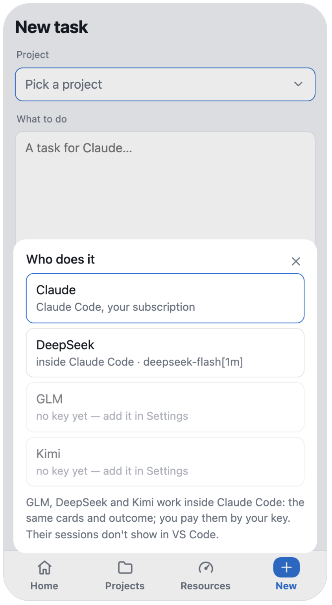
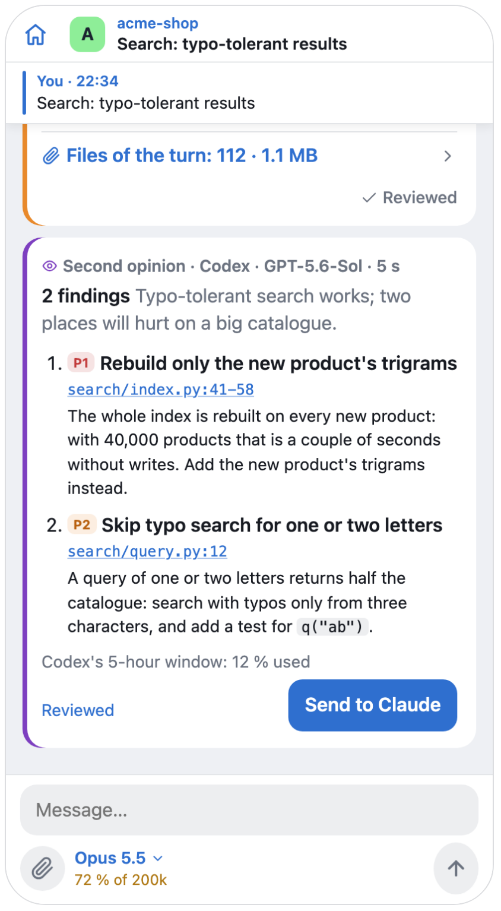

<p align="center"></p>

<h1 align="center">Pult</h1>

<p align="center"><b>The universal remote for AI agents — in Telegram.</b><br>
Claude Code, Codex, DeepSeek in one app: one model does the task, another checks it, and you decide from your phone.</p>

<p align="center">
  <a href="https://github.com/pulthq/pult/actions/workflows/tests.yml"></a>
  <a href="https://github.com/pulthq/pult/releases"></a>
  <a href="LICENSE"></a>
</p>

<p align="center"><a href="#at-a-glance">At a glance</a> · <a href="#install">Install</a> · <a href="#how-it-works">How it works</a> · <a href="#what-you-get">What you get</a> · <a href="guide/usage.md">Guide</a> · <a href="README.ru.md">Русский</a></p>

<p align="center">
  <picture>
    <source media="(prefers-color-scheme: dark)" srcset="media/hero.en.dark.gif">
    
  </picture>
</p>

Pult is an app inside Telegram for the AI agents on your computer. From your phone, give a task to Claude Code — on
Claude's models, or on DeepSeek, GLM or Kimi with a key of yours — and when it's done, let Codex read what it changed:
its findings go back to the session in one tap. When an agent stops to ask, your phone rings, and your answer reaches
the session — even the tab open in VS Code. Pult runs on your computer, macOS, Linux or Windows, and opens no port to
the network. *Pult* is Russian for a remote control.

## At a glance

<p align="center">
  <picture>
    <source media="(prefers-color-scheme: dark)" srcset="media/glance.en.dark.png">
    
  </picture>
</p>

Each with its screen: [what you get](#what-you-get). The rest, from ticks on your message to `pult run`:
**[the guide](guide/usage.md)**.

## Install

```
git clone https://github.com/pulthq/pult.git && cd pult && ./install.sh
```

About ten minutes with a Telegram bot of your own; on Windows the installer is `install.ps1`. Codex and the other
vendors are optional: Pult finds Codex where ChatGPT for Mac or the `codex` command is installed, and a vendor's key
goes into the app's Settings. macOS, Linux and Windows: **[the details](guide/install.md)**.

## How it works

<p align="center">
  <picture>
    <source media="(prefers-color-scheme: dark)" srcset="media/steps.en.dark.png">
    
  </picture>
</p>

Every agent works in its own program, signed in as you: Claude Code with your Claude plan, Codex with your ChatGPT
sign-in. Pult doesn't stand in front of them — it drives them. Claude Code's hooks bring every session to Pult, the
ones you opened before leaving too, so there is nothing to start; a permission request races the dialog on the
computer, and whichever answer comes first decides. Another vendor's model works inside Claude Code, in the sessions
Pult starts; Codex reads a task's changes in a read-only sandbox. If Pult isn't running, they all behave as if it
weren't there. The paths, with diagrams: [ARCHITECTURE.md](ARCHITECTURE.md).

## What you get

An app inside Telegram is the main screen; the chat is for the calls. The app needs a small server of yours
([deploy/relay](deploy/relay/README.md)); without it, the chat still carries the calls, your answers and new tasks.

### Whose move, at a glance

What runs right now, each task with its model, then what waits for you — answer a permission or a question right
there. A finished task stays until you mark it **Reviewed**.

<p align="center"><picture><source media="(prefers-color-scheme: dark)" srcset="media/f-home.en.dark.png"></picture></p>

### Any model does the task

New task asks **who does it**: Claude, or DeepSeek, GLM or Kimi with your key. They work inside Claude Code, so the
turns, the cards and the outcome are the same as Claude's. A project can keep its own default, and every card names
the model that did the work.

<p align="center"><picture><source media="(prefers-color-scheme: dark)" srcset="media/f-who.en.dark.png"></picture></p>

### Another model checks it

Under an outcome, **Second opinion · Codex**: OpenAI's agent, on your ChatGPT subscription, reads what the task
changed — with your request and the report, so what was done on purpose isn't taken for a bug. A finding opens its
file at the line; **Send to Claude** — or to DeepSeek, whoever did the task — hands them all back to it.

<p align="center"><picture><source media="(prefers-color-scheme: dark)" srcset="media/f-second.en.dark.png"></picture></p>

### The whole session in your pocket

The conversation live, the outcome with ready replies taken from the agent's own message, the model and the context
by the field. Slide a message to copy it with its formatting.

<p align="center"><picture><source media="(prefers-color-scheme: dark)" srcset="media/f-session.en.dark.png"></picture></p>

### Tasks sorted by Claude

Every task gets a section of the project and a topic in it — nothing to set up. Tap a section to see only its tasks,
tap the tags to correct them, and your corrections teach Claude. In Telegram they end each result as hashtags.

<p align="center"><picture><source media="(prefers-color-scheme: dark)" srcset="media/f-tags.en.dark.png"></picture></p>

### Your plan's pace

Each limit against the even pace, with a forecast: on pace, under or over — and when it would run out.

<p align="center"><picture><source media="(prefers-color-scheme: dark)" srcset="media/f-pace.en.dark.png"></picture></p>

### Files both ways

Forward documents to a project's topic — they land in the project. What the agent made comes back with a tap, and a
file it links to opens right in the app: a page, code at the very line, a picture or a folder.

<p align="center"><picture><source media="(prefers-color-scheme: dark)" srcset="media/f-files.en.dark.png"></picture></p>

### A new project from the phone

An empty folder with git, a `CLAUDE.md` written from your words, or a clone — its topic appears at once.

<p align="center"><picture><source media="(prefers-color-scheme: dark)" srcset="media/f-newproject.en.dark.png"></picture></p>

### Pult looks after itself

Every part in one table: the computer, the app and its server, this phone's copy, the VS Code tabs, the hooks,
Claude Code. A new release goes in with one tap (macOS, Linux) and your app server follows
([once: `install.sh --auto`](deploy/relay/README.md#updates)); a Claude Code version VS Code has downloaded is
checked here before your tabs move to it, and a new Codex against its own protocol before its first review.

<p align="center"><picture><source media="(prefers-color-scheme: dark)" srcset="media/f-parts.en.dark.png"></picture></p>

And:

- **Voice** — a voice message in the topic, or the microphone in the app, arrives as text (Groq Whisper, with a key of yours).
- **Model and effort** — per session, switched while it runs; a default for the sessions Pult starts.
- **Ticks** on your message — sent, read by the agent — and a pager that knows whether you're at the computer.
- **Pinned and hidden projects** — a slide along the row.
- **`pult run`** for your own long commands, reported like a turn.

**[All of it](guide/usage.md)**.

## Where it's going

The next steps of the universal remote, one release each:

- **Spend by vendor** — Resources shows what each vendor took: Codex's windows, the dollars of each key, beside your
  Claude plan's limits.
- **Codex as a doer** — a task done by Codex itself, with the same cards, questions and permissions.
- **Hand a task over** — midway, to another vendor: what you asked, what is done, the changes and what is left.

## Next to the official options

Anthropic has its own ways to reach Claude Code away from the keyboard. If they fit you, use them.

| | Pult | [Remote Control](https://code.claude.com/docs/en/remote-control) | [Channels](https://code.claude.com/docs/en/channels) |
|---|---|---|---|
| Where you answer | an app inside Telegram, and the chat | claude.ai/code or the Claude app | Telegram, Discord or iMessage |
| Which sessions | every VS Code tab and terminal session, picked up by hooks | the ones you connect, or all with its auto-connect setting | a session started with `claude --channels …` |
| Other vendors | DeepSeek, GLM or Kimi inside Claude Code; Codex reviews the work | — | — |
| Your sign-in | whatever Claude Code is signed in with | a claude.ai plan; API keys aren't supported | claude.ai or a Console API key |
| Status | independent, open source | official | official, research preview |

## Safe by default

Only your Telegram account, only in your group. No port opened; the optional relay stores nothing. No telemetry.
A project's code goes to another vendor only once you allow that project, and a vendor's session never starts
without your key. Pult drives the agents already signed in on your computer, with your plans — read their terms and
decide for yourself. **[Security, privacy and your plans](guide/usage.md#security-and-privacy)** · [SECURITY.md](SECURITY.md)

Pult is an independent open-source project, not affiliated with or endorsed by Anthropic, OpenAI or any other vendor
it works with. Claude and Claude Code are trademarks of Anthropic, Codex and ChatGPT of OpenAI; other names belong to
their owners.

---

[Install](guide/install.md) · [Using it](guide/usage.md) · [Troubleshooting](guide/troubleshooting.md) ·
[Architecture](ARCHITECTURE.md) · [Contributing](CONTRIBUTING.md) · [Changelog](CHANGELOG.md) · [MIT](LICENSE)
