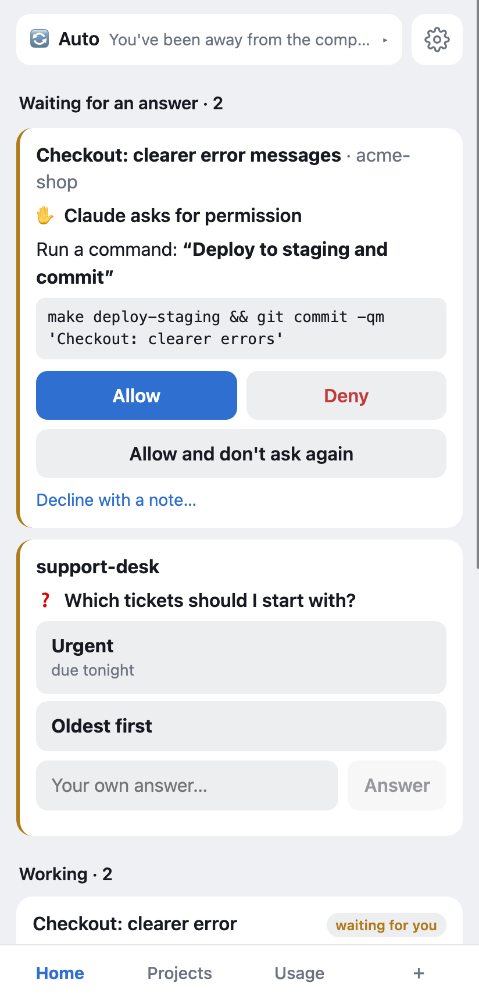
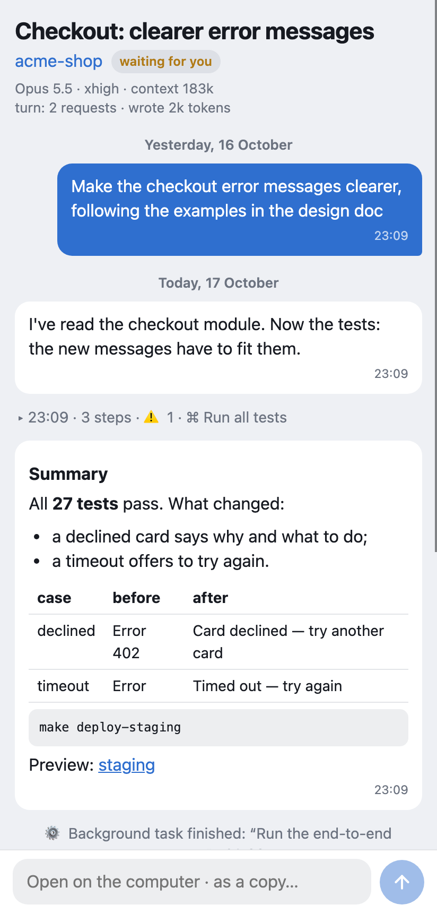
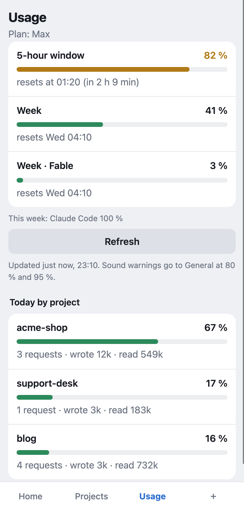

# Pult

**A Telegram remote for the Claude Code sessions on your computer.**

[](https://github.com/pulthq/pult/actions/workflows/tests.yml)
&nbsp;MIT · macOS and Linux · English and Russian · [Русский](README.ru.md)

You start Claude Code in VS Code or a terminal, step away, and the computer keeps working. It asks for permissions,
asks questions and finishes tasks while nobody is there. Pult brings every Claude Code session on your computer into
a Telegram group, one topic per project. In each topic you see the turn as it runs, the result, and Claude's
questions and permission requests, with buttons. You can answer from your phone, continue a session, start a new
one, or write straight into a VS Code tab that is already open.

*Pult* is Russian for a remote control.

<p align="center">
  
  
  
</p>
<p align="center"><sub>The optional web app inside Telegram. Made-up sessions from the test stand.</sub></p>

## What it does

- **Every session, automatically.** VS Code tabs and terminal sessions show up in their project's topic by
  themselves, through Claude Code hooks. You don't start anything per session.
- **One live message per turn** shows how long it has been running and what Claude is doing. The result arrives
  as a separate message:
  ```
  ⏳ Checkout: clearer error messages · working 6 min
  You: “Make the checkout error messages clearer”

  💬 Deploying to staging and checking the checkout page there.
  ```
- **Permissions and questions as buttons.** The dialog on the computer stays open, and whichever side answers
  first decides.
  ```
  ✋ Checkout: clearer error messages · Claude asks for permission
  Run a command: “Deploy to staging and commit”
  make deploy-staging && git commit -qm 'Checkout: clearer errors'
  [✅ Allow]  [❌ Deny]  [♾ Allow and don't ask again]
  ```
- **Write back.** Text in a project topic goes to the topic's current session — the one you chose last, or the
  only one open; otherwise Pult asks once. A reply to a session's message continues that session, `/new text`
  starts a new one. Text, photos and files all go to Claude: files are saved on the computer, and Claude gets
  their path.
- **Straight into an open VS Code tab** (optional). Your message appears in the tab as if you typed it there, and
  the turn runs in it.
- **Notification modes.** 🔄 Auto plays a sound when you've been away from the computer for 2+ minutes. 💻 At my
  computer is silent. 📱 On my phone always plays a sound. Switch with one tap in the pinned panel, or with
  `/desk`, `/phone` or `/auto`.
- **Reminders and warnings.** You get a reminder when a turn runs for 10, 30 or 60 minutes, and a warning when
  your plan's usage reaches 80 % and 95 %.
- **Any long command, not only Claude.** `pult run -- npm run build` reports start, progress, the exit code and
  the last lines of output.
- **The web app** (optional, on your own server) is a Telegram Mini App. It shows every session in full and live,
  your plan's limits, today's tokens by project, and has a form for new tasks. It's one tap away: the 📱 Pult
  button pinned at the top of each project topic opens that project, and your private chat with the bot has a
  Pult button next to the message field.

## How it differs from the official options

Anthropic has its own ways to reach Claude Code away from the keyboard. If they fit you, use them:

- **[Remote Control](https://code.claude.com/docs/en/remote-control)** connects claude.ai/code or the Claude app
  for iOS and Android to a Claude Code session running on your machine.
- **[Channels](https://code.claude.com/docs/en/channels)** (a research preview) let an MCP server, including
  ready-made Telegram, Discord and iMessage plugins, push messages into a running Claude Code session.

Pult is built for a different way of working:

- **Telegram as the place where everything lands.** You don't need the Claude app.
- **All sessions on the computer at once, with nothing to start.** Hooks pick up every VS Code tab and terminal
  session, including ones you opened before leaving.
- **One group with a topic per project**, keeping the history of turns, results and decisions.
- **Writing into a tab that is already open** in VS Code, not only into sessions started for remote use.
- **Everything runs on your computer.** The only outside service is Telegram (plus your own server, if you want the
  web app).

## Requirements

- macOS or Linux. Tested on macOS 26 (Apple Silicon) and Ubuntu 24.04 (arm64).
- Claude Code, signed in: the VS Code extension, the CLI, or both. Tested with the extension 2.1.301 and the
  Agent SDK 0.2.167.
- Python 3.10 or newer. On a Mac with Homebrew: `brew install python@3.12`. On Debian or Ubuntu:
  `sudo apt update && sudo apt install python3 python3-venv`.
- Telegram, and a bot of your own (created in @BotFather; the setup walks you through it).
- Optional, for the web app: a Linux server with a domain name and HTTPS.

## Install (about 10 minutes)

```
git clone https://github.com/pulthq/pult.git
cd pult
./install.sh
```

The installer creates its own Python environment in `~/.local/share/pult`, puts the `pult` command into
`~/.local/bin` and adds a background service (launchd on macOS, a systemd user service on Linux). Then the setup wizard takes four steps:

1. **Bot.** In Telegram, open @BotFather → `/newbot`, and paste the token it gives you.
2. **You.** Open the link the wizard shows, on your phone, and tap **Start**. Pult learns your Telegram ID and
   language.
3. **Group.** Create a group and turn on **Topics**. Add the bot as an admin with **Manage Topics** and **Pin
   Messages**, then send `/bind@your_bot` in the group. The wizard checks all of this and tells you what's
   missing.
4. **Hooks.** Pult adds its hooks to `~/.claude/settings.json`. Your other settings stay as they are, and a
   backup copy is made first.

Then, in VS Code: Cmd+Shift+P (Ctrl+Shift+P on Linux) → **Developer: Reload Window**, so that open tabs pick up
the hooks. Run
`pult setup` again any time to change the bot, the owner or the group.

Optional:

- `pult tab setup` writes Telegram messages straight into open VS Code tabs. It prints one line to add to the VS
  Code settings.
- `pult app` sets up the web app. It needs your own server: see [deploy/relay/README.md](deploy/relay/README.md).

### On Linux

Pult goes where Claude Code runs:

- **A Linux desktop with VS Code or a terminal**: the same as on a Mac.
- **A server you open in VS Code through Remote-SSH**: Claude Code runs on the server, so install Pult there. The
  line from `pult tab setup` goes into the server's settings: in a window connected to it, Ctrl+Shift+P →
  **Preferences: Open Remote Settings (JSON)**.
- **Claude Code in a terminal on a server, over SSH**: sessions, permissions and questions come to Telegram the
  same way.

On a server, a user's services stop when they log out. To keep Pult running, and start it at boot:
`sudo loginctl enable-linger $USER` (the installer reminds you).

Whether you're away from the computer (the sound in 🔄 Auto) comes from GNOME, KDE or X11. Elsewhere (a server,
another desktop) it comes from what you do in sessions: a prompt typed or a permission answered in the last two
minutes.

## Using it

Work on the computer as usual. In Telegram:

| | |
|---|---|
| a project's topic | its sessions' turns, results, questions and permission requests |
| reply to a session's message | continue that session |
| text in a project's topic | the topic's current session (🎯 in the pinned card); none — the only open one, else Pult asks once |
| `/new text`, or `/new` and then the text | a new session in this topic's project |
| `/desk` `/phone` `/auto` `/mode` | notification mode |
| `/status` | what's open on the computer right now |
| `/projects`, `/sessions` | projects with their topics; recent sessions of this project |
| `/stop` | interrupt the topic's current session started from Telegram; as a reply — that session |
| `/app`, 📱 Pult in a topic's pinned bar | open the web app (from a topic — on that project) |
| `/help` | everything above, in sections |

In a terminal, `pult help` lists the commands: `status`, `setup`, `start|stop|restart`, `hooks on|off`,
`tab …`, `app`, `run`, `report`, `uninstall`.

## How it works

```
VS Code tabs, terminal ──hooks──► pult_hook.py ──unix socket──► pultd (your computer) ──────► Telegram Bot API
                                                                   │
Telegram on your phone ────────────────────────────────────────►  ├──Agent SDK──► Claude Code (sessions from Telegram)
                                                                   ├──► the tab wrapper ──► an open VS Code tab
web app (optional): Mini App ──► relay on your server ◄── pultd connects out, no open ports on the computer
```

- **Hooks** (`SessionStart`, `UserPromptSubmit`, `PostToolUse`, `Stop`, `SessionEnd`, `PermissionRequest`)
  pass each event to the daemon. The hook never gets in the way. If the daemon isn't running or anything goes
  wrong, it exits quietly and Claude Code behaves as if it weren't there.
- **Permission requests.** The hook waits for your answer from Telegram while the dialog on the computer stays
  open.
  Claude Code takes whichever answer comes first and ignores a later one.
- **Sessions from Telegram** run through the Claude Agent SDK. That is your Claude Code, in the project's
  folder, with your settings and Claude Code's own system prompt. By default they use Claude Code's `auto` permission mode (`PULT_PERMISSION_MODE`). Anything Claude Code asks
  about comes to Telegram as buttons.
- **Writing into an open tab** uses an optional wrapper (`claudeCode.claudeProcessWrapper`) between VS Code and
  Claude Code. It passes everything through byte for byte and adds your message to the tab's input. It acts only
  on Claude Code versions it was checked on, and runs Claude Code directly in any other case.
- **Honest caveat.** Some of this relies on Claude Code internals: hook payloads, and the tab's message stream.
  When the Claude Code extension updates, Pult turns writing into tabs off until the new version is checked, and
  tells you so. Until then, messages to open tabs go to a copy of the session.

## Security and privacy

- **Who can control your computer.** Only the Telegram account(s) in `PULT_ALLOWED_USER_IDS` (you), and only in the
  bound group. Anyone who gets into your Telegram account can run Claude Code on your computer with your
  user's rights, so turn on Telegram's two-step verification.
- **The bot token is a key.** It lives in `~/.config/pult/env` (mode 600). If it leaks, `/revoke` it in
  @BotFather and run `pult setup`.
- **What goes to Telegram:** your prompts, Claude's replies (shortened in the chat), step names, permission
  requests (commands, file names) and questions. Telegram stores it in its cloud like any chat. Bot chats are not
  end-to-end encrypted.
- **The web app relay** stores nothing. It cuts off strangers by Telegram's signature and your ID. The computer
  checks every login again with the bot token, which never leaves it. The data passes through your server
  over TLS.
- **No telemetry.** Logs stay on the computer: `~/Library/Logs` on macOS, `~/.local/state/pult` on Linux. `pult report` prints versions and state with tokens, IDs,
  folder names and message text removed, for a bug report.
- **Vulnerabilities:** report them privately, see [SECURITY.md](SECURITY.md).

## Claude Code, your plan and Anthropic

Pult has no login and no model of its own. It drives the Claude Code already installed and signed in on your
computer, with your account and your plan's limits, the same as you would in a terminal. Anthropic's
[Agent SDK documentation](https://code.claude.com/docs/en/agent-sdk/overview) says: *"Unless previously approved,
Anthropic does not allow third party developers to offer claude.ai login or rate limits for their products,
including agents built on the Claude Agent SDK."* Pult doesn't offer a login: it runs your own Claude Code for
you. Still, read the terms of your plan and decide for yourself. Claude Code can also be signed in with an
Anthropic API key; Pult hasn't been tested that way yet.

Pult is an independent open-source project, not affiliated with or endorsed by Anthropic. Claude and Claude Code
are trademarks of Anthropic.

## Turn it off, remove it

- `pult hooks off`, then Reload Window: Pult stops seeing sessions.
- `pult stop`: the service stops. `pult start` starts it again.
- `pult tab off`: new VS Code tabs start without the wrapper.
- `pult uninstall`: removes the service, the hooks, the `pult` command and Pult's files, and asks whether to also
  delete your settings with the bot token. The bot and the group stay in Telegram.

Claude Code works exactly as before without Pult.

## Troubleshooting

| | |
|---|---|
| The bot is silent | `pult status` shows the service and the connection to Telegram. `pult restart`. The log is `~/Library/Logs/pult.log` on macOS, `~/.local/state/pult/pult.log` on Linux. |
| Linux: Pult stops when you log out | `sudo loginctl enable-linger $USER`. |
| No sessions from VS Code | The hooks are off: `pult hooks on`, then Reload Window. |
| `409` in the log | Another program is reading this bot's updates, such as a second copy of Pult. |
| No permission buttons, but the feed works | Claude Code's `auto` mode decides by itself. That's normal. |
| A message to an open tab went to a copy | The tab was opened before the wrapper was set up (Reload Window), or the Claude Code extension just updated (Pult said so in General). |
| Something else | `pult report`, then [open an issue](https://github.com/pulthq/pult/issues/new/choose). |

**Windows?** Not yet: it comes next.

**Several people?** No. One Pult has one owner.

**Extra cost?** No. Pult uses only what the sessions themselves use. The usage screen asks Claude Code for your
limits without a model request.

## Contributing

Bug reports, ideas and pull requests are welcome: [CONTRIBUTING.md](CONTRIBUTING.md). The history of changes is in
[CHANGELOG.md](CHANGELOG.md).

## License

[MIT](LICENSE)
