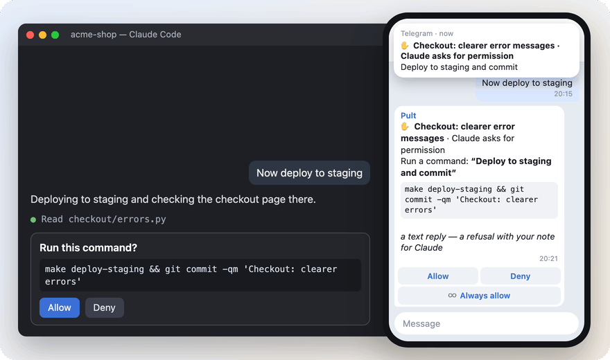
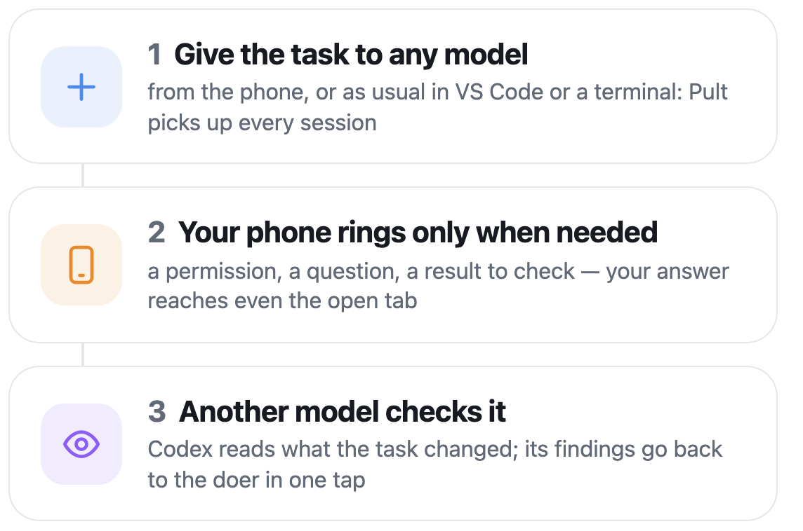
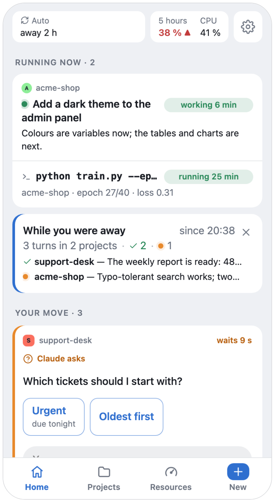
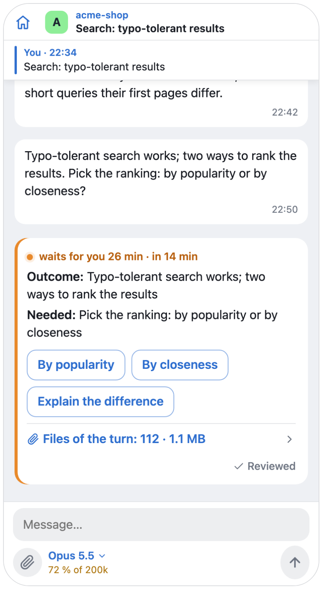
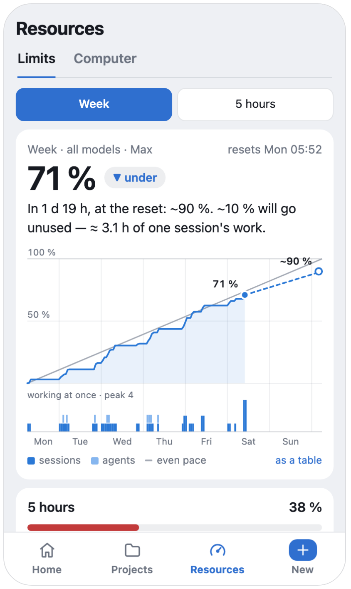
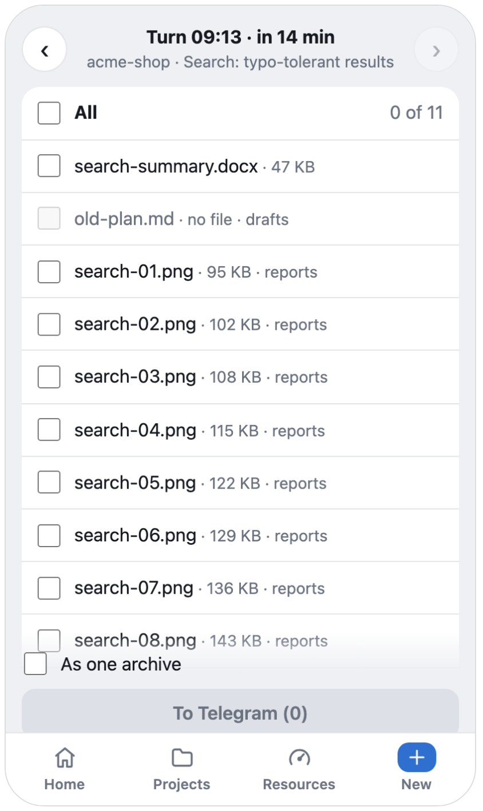
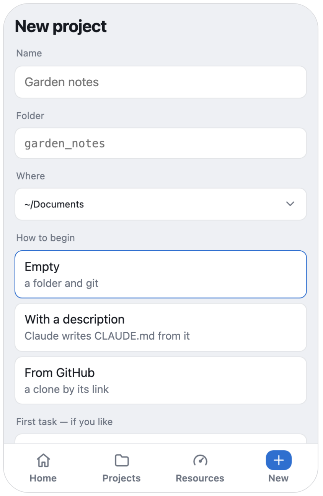

<p align="center"></p>

<h1 align="center">Pult</h1>

<p align="center"><b>Every Claude Code session on your computer — in Telegram.</b><br>
Claude asks — your phone rings. You answer — the open VS Code tab goes on.</p>

<p align="center">
  <a href="https://github.com/pulthq/pult/actions/workflows/tests.yml"></a>
  <a href="https://github.com/pulthq/pult/releases"></a>
  <a href="LICENSE"></a>
</p>

<p align="center"><a href="#install">Install</a> · <a href="#how-it-works">How it works</a> · <a href="#what-you-get">What you get</a> · <a href="guide/usage.md">Guide</a> · <a href="README.ru.md">Русский</a></p>

<p align="center">
  <picture>
    <source media="(prefers-color-scheme: dark)" srcset="media/hero.en.dark.gif">
    
  </picture>
</p>

You give Claude Code a task and walk away. When Claude stops to ask, **Pult** rings your phone in the project's
Telegram topic, and your answer reaches the session — even the tab open in VS Code. It runs on your computer and
opens no port to the network. *Pult* is Russian for a remote control.

## Install

```
git clone https://github.com/pulthq/pult.git && cd pult && ./install.sh
```

About ten minutes with a Telegram bot of your own; on Windows the installer is `install.ps1`. macOS, Linux and
Windows: **[the details](guide/install.md)**.

## How it works

<p align="center">
  <picture>
    <source media="(prefers-color-scheme: dark)" srcset="media/steps.en.dark.png">
    
  </picture>
</p>

Claude Code's hooks bring every session to Pult, the ones you opened before leaving too — there is nothing to start.
A permission request races the dialog on the computer: whichever answer comes first decides. If Pult isn't running,
Claude Code behaves as if it weren't there. The paths, with diagrams: [ARCHITECTURE.md](ARCHITECTURE.md).

## What you get

Telegram for the calls, a Mini App inside it for the rest. The app needs a small server of yours
([deploy/relay](deploy/relay/README.md)); without it, everything works in the chat alone.

### Whose move, at a glance

What runs right now, then what waits for you — answer a permission or a question right there.

<p align="center"><picture><source media="(prefers-color-scheme: dark)" srcset="media/f-home.en.dark.png"></picture></p>

### The whole session in your pocket

The conversation live, the outcome with ready replies taken from Claude's own message, the model and the context
by the field.

<p align="center"><picture><source media="(prefers-color-scheme: dark)" srcset="media/f-session.en.dark.png"></picture></p>

### Your plan's pace

Each limit against the even pace, with a forecast: on pace, under or over — and when it would run out.

<p align="center"><picture><source media="(prefers-color-scheme: dark)" srcset="media/f-pace.en.dark.png"></picture></p>

### Files both ways

Forward documents to a project's topic — they land in the project. What Claude made comes back with a tap. A file
Claude links to in a reply opens right in the app: a page, code at the very line, a picture or a folder.

<p align="center"><picture><source media="(prefers-color-scheme: dark)" srcset="media/f-files.en.dark.png"></picture></p>

### A new project from the phone

An empty folder with git, a `CLAUDE.md` Claude writes from your words, or a clone — its topic appears at once.

<p align="center"><picture><source media="(prefers-color-scheme: dark)" srcset="media/f-newproject.en.dark.png"></picture></p>

And: tags on every task — the section of the project and the topic in it, kept by Claude (switch them on in Settings), corrected with a tap — voice
messages as text, the model and effort per session and a default for both, a pager that knows whether you're at the computer,
ticks on your message — sent, read by Claude — `pult run` for your own long commands, a new release installed from the
app with one tap (macOS, Linux) — Pult finds it on GitHub by itself, and your app server takes the same one from GitHub
after the computer ([once: `install.sh --auto`](deploy/relay/README.md#updates)) — every part of Pult in one table — what runs where and how far it is behind `main`. **[All of it](guide/usage.md)**.

## Next to the official options

Anthropic has its own ways to reach Claude Code away from the keyboard. If they fit you, use them.

| | Pult | [Remote Control](https://code.claude.com/docs/en/remote-control) | [Channels](https://code.claude.com/docs/en/channels) |
|---|---|---|---|
| Where you answer | Telegram, plus an optional web app inside it | claude.ai/code or the Claude app | Telegram, Discord or iMessage |
| Which sessions | every VS Code tab and terminal session, picked up by hooks | the ones you connect, or all with its auto-connect setting | a session started with `claude --channels …` |
| Your sign-in | whatever Claude Code is signed in with | a claude.ai plan; API keys aren't supported | claude.ai or a Console API key |
| Status | independent, open source | official | official, research preview |

## Safe by default

Only your Telegram account, only in your group. No port opened; the optional relay stores nothing. No telemetry.
Pult drives the Claude Code already signed in on your computer, with your plan — read its terms and decide for
yourself. **[Security, privacy and your plan](guide/usage.md#security-and-privacy)** · [SECURITY.md](SECURITY.md)

Pult is an independent open-source project, not affiliated with or endorsed by Anthropic. Claude and Claude Code
are trademarks of Anthropic.

---

[Install](guide/install.md) · [Using it](guide/usage.md) · [Troubleshooting](guide/troubleshooting.md) ·
[Architecture](ARCHITECTURE.md) · [Contributing](CONTRIBUTING.md) · [Changelog](CHANGELOG.md) · [MIT](LICENSE)
