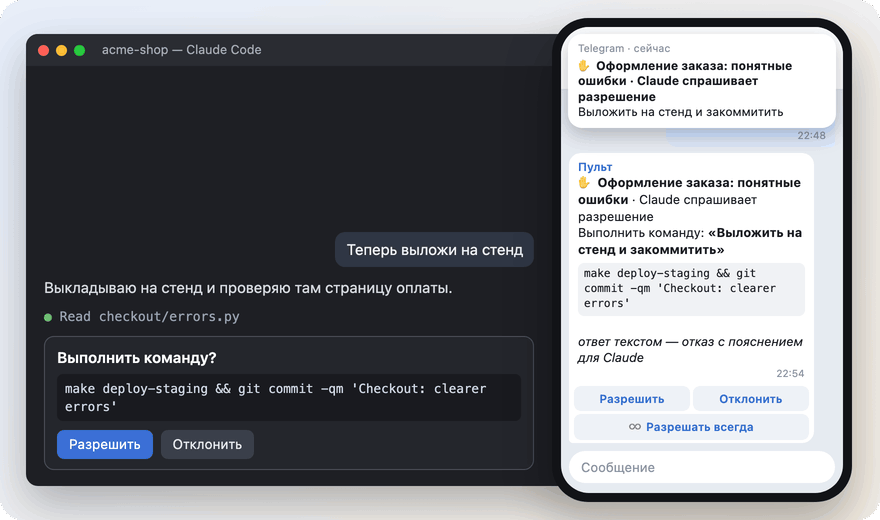
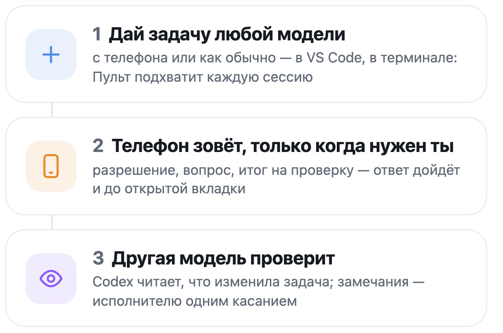
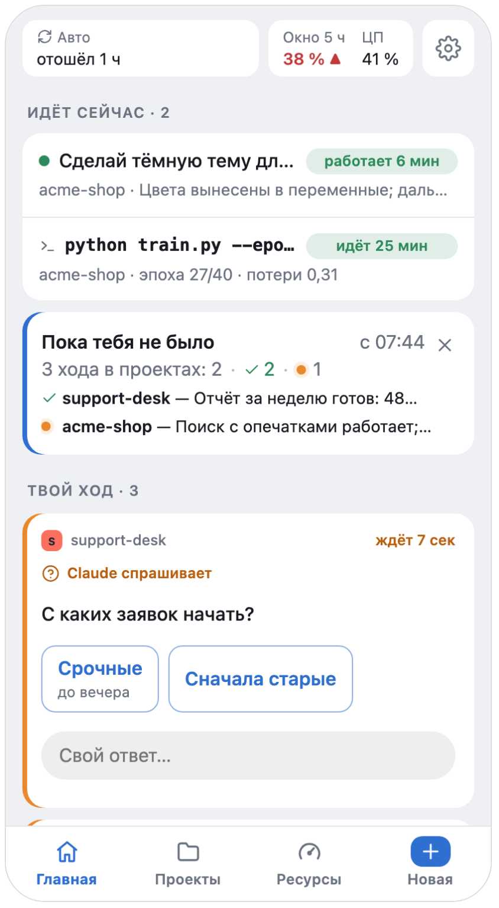
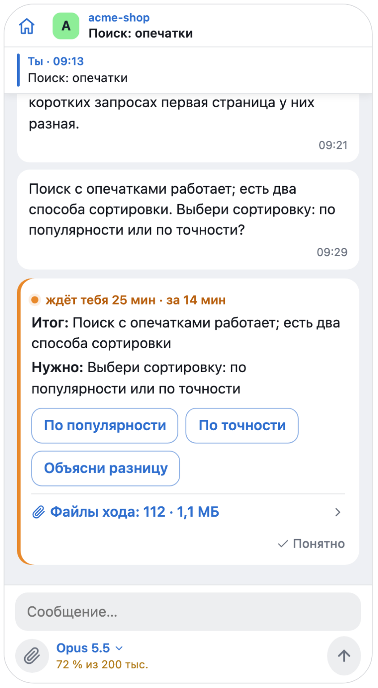
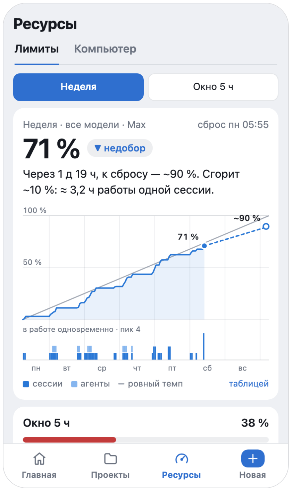
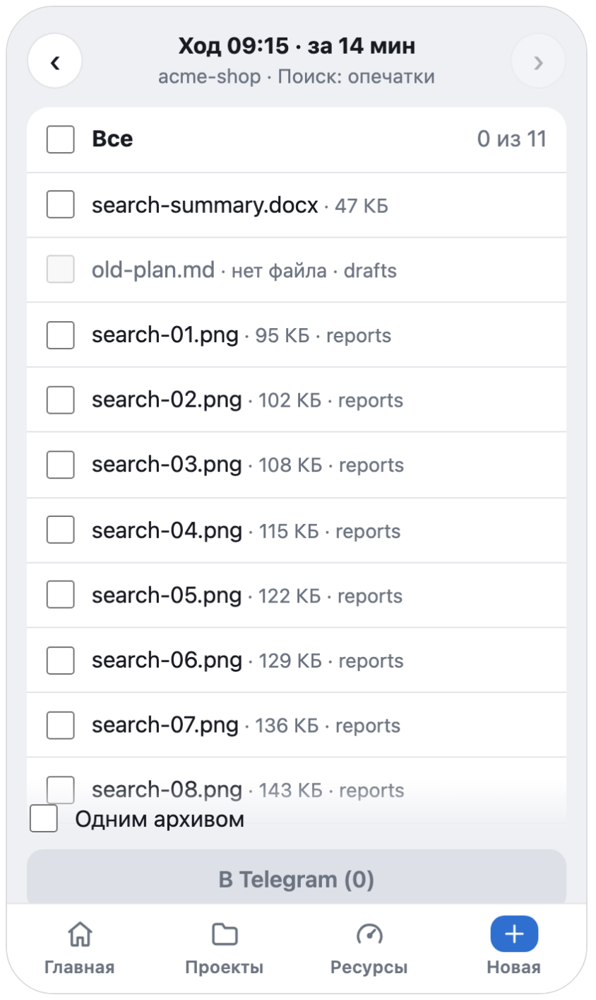
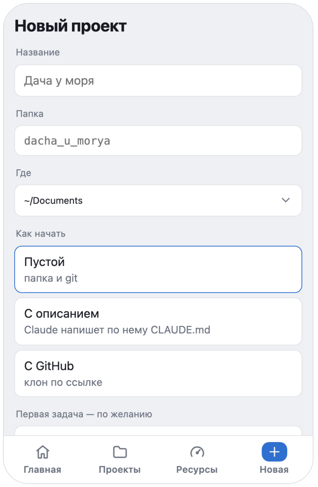

<p align="center"></p>

<h1 align="center">Pult</h1>

<p align="center"><b>Каждая сессия Claude Code на твоём компьютере — в Telegram.</b><br>
Claude спросил — телефон позвал. Ты ответил — открытая вкладка VS Code пошла дальше.</p>

<p align="center">
  <a href="https://github.com/pulthq/pult/actions/workflows/tests.yml"></a>
  <a href="https://github.com/pulthq/pult/releases"></a>
  <a href="LICENSE"></a>
</p>

<p align="center"><a href="#установка">Установка</a> · <a href="#как-устроено">Как устроено</a> · <a href="#что-даёт">Что даёт</a> · <a href="guide/usage.ru.md">Руководство</a> · <a href="README.md">English</a></p>

<p align="center">
  <picture>
    <source media="(prefers-color-scheme: dark)" srcset="media/hero.ru.dark.gif">
    
  </picture>
</p>

Ты даёшь Claude Code задачу и отходишь. Когда Claude останавливается спросить, **Пульт** зовёт тебя в теме проекта
в Telegram, и твой ответ доходит до сессии — даже до вкладки, открытой в VS Code. Пульт работает на твоём компьютере
и не открывает на нём портов в сеть.

## Установка

```
git clone https://github.com/pulthq/pult.git && cd pult && ./install.sh
```

Минут десять вместе со своим ботом в Telegram; на Windows установщик — `install.ps1`. macOS, Linux и Windows:
**[подробно](guide/install.ru.md)**.

## Как устроено

<p align="center">
  <picture>
    <source media="(prefers-color-scheme: dark)" srcset="media/steps.ru.dark.png">
    
  </picture>
</p>

Хуки Claude Code приводят к Пульту каждую сессию — и те, что ты открыл до ухода: запускать ничего не надо. Запрос
разрешения идёт наперегонки с окном на компьютере: решает ответ, пришедший первым. Если Пульт не запущен, Claude Code
ведёт себя так, будто его нет. Все пути, со схемами: [ARCHITECTURE.ru.md](ARCHITECTURE.ru.md).

## Что даёт

Telegram — чтобы позвать, мини-приложение внутри него — для остального. Приложению нужен твой небольшой сервер
([deploy/relay](deploy/relay/README.md)); без него всё работает в одном чате.

### Чей ход — с одного взгляда

Что идёт сейчас, ниже — что ждёт тебя: разрешение или вопрос, ответ прямо там.

<p align="center"><picture><source media="(prefers-color-scheme: dark)" srcset="media/f-home.ru.dark.png"></picture></p>

### Вся сессия в кармане

Переписка вживую, итог с готовыми ответами из сообщения самого Claude, модель и контекст у поля ввода.

<p align="center"><picture><source media="(prefers-color-scheme: dark)" srcset="media/f-session.ru.dark.png"></picture></p>

### Темп подписки

Каждый лимит против ровного темпа, с прогнозом: в темпе, недобор или перебор — и когда кончится.

<p align="center"><picture><source media="(prefers-color-scheme: dark)" srcset="media/f-pace.ru.dark.png"></picture></p>

### Файлы туда и обратно

Перешли документы в тему проекта — они лягут в проект. Сделанное Claude вернётся в тему одним касанием.

<p align="center"><picture><source media="(prefers-color-scheme: dark)" srcset="media/f-files.ru.dark.png"></picture></p>

### Новый проект с телефона

Пустая папка с git, `CLAUDE.md`, который Claude напишет по твоим словам, или клон — тема появится сразу.

<p align="center"><picture><source media="(prefers-color-scheme: dark)" srcset="media/f-newproject.ru.dark.png"></picture></p>

И ещё: голосовые в текст, модель и раздумья для каждой сессии, пейджер, который знает, за компьютером ли ты,
галочки у твоего сообщения — отправлено, Claude прочёл, — `pult run` для своих долгих команд, обновление из приложения
после `git pull` (macOS, Linux). **[Всё целиком](guide/usage.ru.md)**.

## Рядом с официальными способами

У Anthropic есть свои способы дотянуться до Claude Code не из-за клавиатуры. Если они подходят — пользуйся ими.

| | Пульт | [Remote Control](https://code.claude.com/docs/en/remote-control) | [Channels](https://code.claude.com/docs/en/channels) |
|---|---|---|---|
| Где отвечаешь | Telegram, плюс веб-приложение внутри него по желанию | claude.ai/code или приложение Claude | Telegram, Discord или iMessage |
| Какие сессии | каждая вкладка VS Code и сессия в терминале, через хуки | те, что подключишь, или все — с его настройкой автоподключения | сессия, запущенная как `claude --channels …` |
| Вход | любой, с которым работает Claude Code | подписка claude.ai; ключи API не поддерживаются | claude.ai или ключ API Console |
| Статус | независимый, открытый код | официальный | официальный, исследовательская версия |

## Безопасно по умолчанию

Только твой аккаунт Telegram, только в твоей группе. Портов в сеть нет; посредник по желанию ничего не хранит.
Никакой телеметрии. Пульт управляет Claude Code, который уже вошёл в аккаунт на твоём компьютере, с твоей
подпиской — прочитай её условия и реши сам. **[Безопасность, приватность и подписка](guide/usage.ru.md#безопасность-и-приватность)** ·
[SECURITY.md](SECURITY.md)

Pult — независимый проект с открытым кодом, не связан с Anthropic и не одобрен ею. Claude и Claude Code —
товарные знаки Anthropic.

---

[Установка](guide/install.ru.md) · [Как пользоваться](guide/usage.ru.md) · [Если что-то не так](guide/troubleshooting.ru.md) ·
[Устройство](ARCHITECTURE.ru.md) · [Участие](CONTRIBUTING.md) · [История](CHANGELOG.md) · [MIT](LICENSE)
