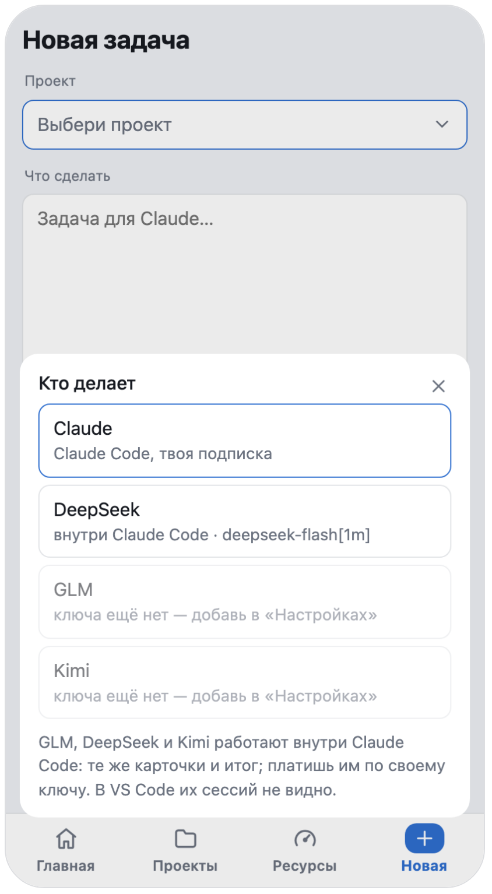
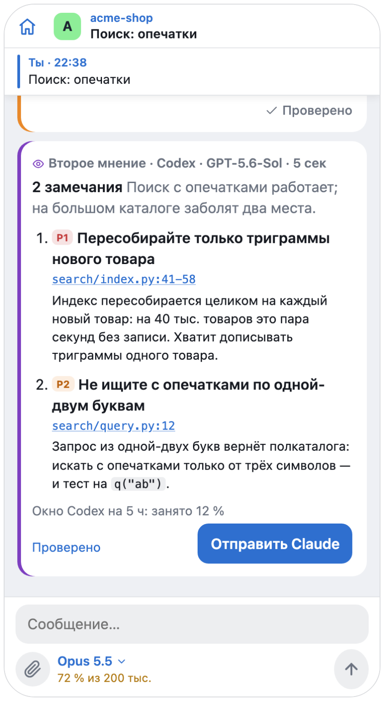
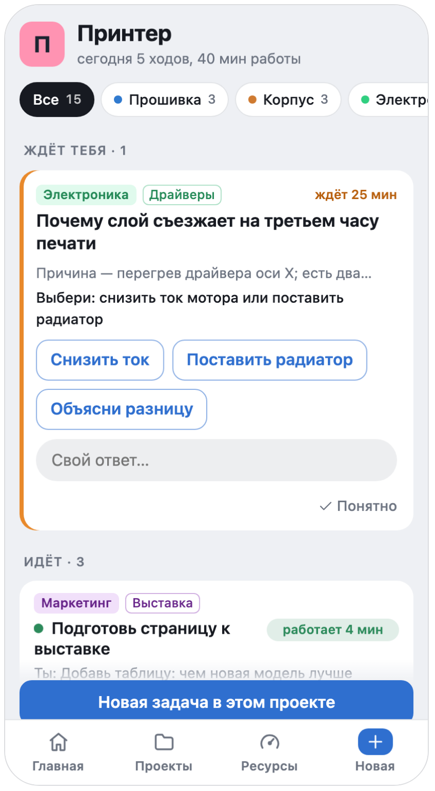
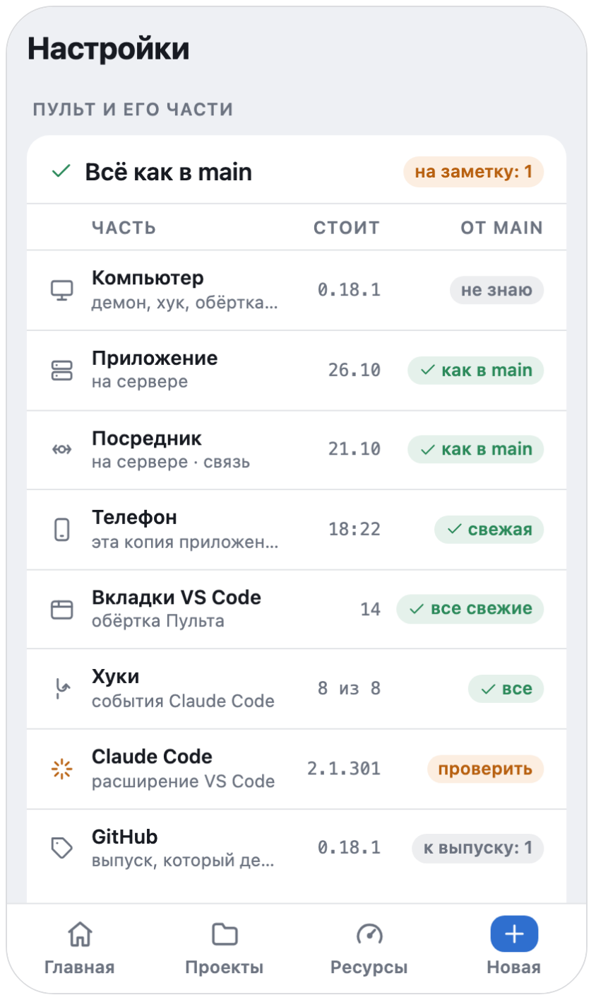

<p align="center"></p>

<h1 align="center">Pult</h1>

<p align="center"><b>Универсальный пульт для ИИ-агентов — в Telegram.</b><br>
Claude Code, Codex, DeepSeek в одном приложении: одна модель делает задачу, другая проверяет, а решаешь ты — с телефона.</p>

<p align="center">
  <a href="https://github.com/pulthq/pult/actions/workflows/tests.yml"></a>
  <a href="https://github.com/pulthq/pult/releases"></a>
  <a href="LICENSE"></a>
</p>

<p align="center"><a href="#с-одного-взгляда">С одного взгляда</a> · <a href="#установка">Установка</a> · <a href="#как-устроено">Как устроено</a> · <a href="#что-даёт">Что даёт</a> · <a href="guide/usage.ru.md">Руководство</a> · <a href="README.md">English</a></p>

<p align="center">
  <picture>
    <source media="(prefers-color-scheme: dark)" srcset="media/hero.ru.dark.gif">
    
  </picture>
</p>

Пульт — приложение внутри Telegram для ИИ-агентов на твоём компьютере. С телефона дай задачу Claude Code — на моделях
Claude или на DeepSeek, GLM, Kimi по своему ключу, — а когда она готова, пусть Codex прочтёт, что она изменила: его
замечания уйдут в сессию одним касанием. Когда агент останавливается спросить, телефон зовёт тебя, и ответ доходит до
сессии — даже до вкладки, открытой в VS Code. Пульт работает на твоём компьютере — macOS, Linux или Windows — и не
открывает на нём портов в сеть.

## С одного взгляда

<p align="center">
  <picture>
    <source media="(prefers-color-scheme: dark)" srcset="media/glance.ru.dark.png">
    
  </picture>
</p>

Каждое — со своим экраном: [что даёт](#что-даёт). Остальное, от галочек у сообщения до `pult run`:
**[руководство](guide/usage.ru.md)**.

## Установка

```
git clone https://github.com/pulthq/pult.git && cd pult && ./install.sh
```

Минут десять вместе со своим ботом в Telegram; на Windows установщик — `install.ps1`. Codex и другие производители —
по желанию: Codex Пульт найдёт сам, если стоит ChatGPT для Mac или команда `codex`, а ключ производителя кладётся
в «Настройках» приложения. macOS, Linux и Windows: **[подробно](guide/install.ru.md)**.

## Как устроено

<p align="center">
  <picture>
    <source media="(prefers-color-scheme: dark)" srcset="media/steps.ru.dark.png">
    
  </picture>
</p>

Каждый агент работает в своей родной программе, под твоим входом: Claude Code — с твоей подпиской Claude, Codex —
с твоим входом в ChatGPT. Пульт не встаёт перед ними — он ими управляет. Хуки Claude Code приводят к Пульту каждую
сессию — и те, что ты открыл до ухода: запускать ничего не надо; запрос разрешения идёт наперегонки с окном на
компьютере, и решает ответ, пришедший первым. Модель другого производителя работает внутри Claude Code, в сессиях,
которые запускает Пульт; Codex читает изменения задачи в песочнице только для чтения. Если Пульт не запущен, все они
ведут себя так, будто его нет. Все пути, со схемами: [ARCHITECTURE.ru.md](ARCHITECTURE.ru.md).

## Что даёт

Приложение внутри Telegram — главный экран, чат — чтобы позвать. Приложению нужен твой небольшой сервер
([deploy/relay](deploy/relay/README.md)); без него в чате остаются вызовы, твои ответы и новые задачи.

### Чей ход — с одного взгляда

Что идёт сейчас, у каждой задачи — её модель, ниже — что ждёт тебя: разрешение или вопрос, ответ прямо там.
Законченная задача ждёт, пока не отметишь её «Проверено».

<p align="center"><picture><source media="(prefers-color-scheme: dark)" srcset="media/f-home.ru.dark.png"></picture></p>

### Задачу делает любая модель

«Новая задача» спрашивает, **кто делает**: Claude или DeepSeek, GLM, Kimi по твоему ключу. Они работают внутри
Claude Code, поэтому ходы, карточки и итог — те же, что у Claude. У проекта может быть свой исполнитель по умолчанию,
а каждая карточка называет модель, которая сделала работу.

<p align="center"><picture><source media="(prefers-color-scheme: dark)" srcset="media/f-who.ru.dark.png"></picture></p>

### Другая модель проверяет

Под итогом — **«Второе мнение · Codex»**: агент OpenAI, по твоей подписке ChatGPT, читает, что изменила задача, —
вместе с твоим запросом и отчётом, чтобы сделанное нарочно не сочлось ошибкой. Замечание открывает свой файл на нужной
строке; **«Отправить Claude»** — или DeepSeek, смотря кто делал задачу, — передаёт их все исполнителю.

<p align="center"><picture><source media="(prefers-color-scheme: dark)" srcset="media/f-second.ru.dark.png"></picture></p>

### Вся сессия в кармане

Переписка вживую, итог с готовыми ответами из сообщения самого агента, модель и контекст у поля ввода. Сообщение
копируется свайпом — с форматированием.

<p align="center"><picture><source media="(prefers-color-scheme: dark)" srcset="media/f-session.ru.dark.png"></picture></p>

### Задачи разобрал Claude

У каждой задачи — раздел проекта и тема в нём, настраивать нечего. Нажми раздел — останутся только его задачи; нажми
теги — поправишь, и твои правки учат Claude. В Telegram теги заканчивают каждый итог хештегами.

<p align="center"><picture><source media="(prefers-color-scheme: dark)" srcset="media/f-tags.ru.dark.png"></picture></p>

### Темп подписки

Каждый лимит против ровного темпа, с прогнозом: в темпе, недобор или перебор — и когда кончится.

<p align="center"><picture><source media="(prefers-color-scheme: dark)" srcset="media/f-pace.ru.dark.png"></picture></p>

### Файлы туда и обратно

Перешли документы в тему проекта — они лягут в проект. Сделанное агентом вернётся одним касанием, а файл, на который он
ссылается, открывается прямо в приложении: страницей, кодом на нужной строке, картинкой или папкой.

<p align="center"><picture><source media="(prefers-color-scheme: dark)" srcset="media/f-files.ru.dark.png"></picture></p>

### Новый проект с телефона

Пустая папка с git, `CLAUDE.md`, написанный по твоим словам, или клон — тема появится сразу.

<p align="center"><picture><source media="(prefers-color-scheme: dark)" srcset="media/f-newproject.ru.dark.png"></picture></p>

### Пульт следит за собой

Все части в одной таблице: компьютер, приложение и его сервер, копия на этом телефоне, вкладки VS Code, хуки,
Claude Code. Новый выпуск встаёт одной кнопкой (macOS, Linux), сервер приложения подтягивается следом
([один раз: `install.sh --auto`](deploy/relay/README.md#updates)); версию Claude Code, которую скачал VS Code, Пульт
проверяет здесь до того, как на неё перейдут вкладки, а новый Codex — по его собственному протоколу до первого ревью.

<p align="center"><picture><source media="(prefers-color-scheme: dark)" srcset="media/f-parts.ru.dark.png"></picture></p>

И ещё:

- **Голосом** — голосовое в теме или микрофон в приложении приходит текстом (Groq Whisper, со своим ключом).
- **Модель и раздумья** — на сессию, переключаются на ходу; по умолчанию — для сессий, которые запускает Пульт.
- **Галочки** у твоего сообщения — отправлено, агент прочёл — и пейджер, который знает, за компьютером ли ты.
- **Закреплённые и скрытые проекты** — свайпом по строке.
- **`pult run`** для своих долгих команд — отчёт как о ходе.

**[Всё целиком](guide/usage.ru.md)**.

## Куда идёт

Следующие шаги универсального пульта, каждый — своим выпуском:

- **Codex исполнителем** — задачу делает сам Codex, с теми же карточками, вопросами и разрешениями.
- **Расход по производителям** — «Ресурсы» показывают, что взял каждый: окна Codex, доллары каждого ключа — рядом
  с лимитами подписки Claude.
- **Передать задачу** — посреди работы, другому производителю: что просил, что сделано, изменения и что осталось.

## Рядом с официальными способами

У Anthropic есть свои способы дотянуться до Claude Code не из-за клавиатуры. Если они подходят — пользуйся ими.

| | Пульт | [Remote Control](https://code.claude.com/docs/en/remote-control) | [Channels](https://code.claude.com/docs/en/channels) |
|---|---|---|---|
| Где отвечаешь | приложение внутри Telegram и чат | claude.ai/code или приложение Claude | Telegram, Discord или iMessage |
| Какие сессии | каждая вкладка VS Code и сессия в терминале, через хуки | те, что подключишь, или все — с его настройкой автоподключения | сессия, запущенная как `claude --channels …` |
| Другие производители | DeepSeek, GLM или Kimi внутри Claude Code; Codex проверяет работу | — | — |
| Вход | любой, с которым работает Claude Code | подписка claude.ai; ключи API не поддерживаются | claude.ai или ключ API Console |
| Статус | независимый, открытый код | официальный | официальный, исследовательская версия |

## Безопасно по умолчанию

Только твой аккаунт Telegram, только в твоей группе. Портов в сеть нет; посредник по желанию ничего не хранит.
Никакой телеметрии. Код проекта уходит другому производителю, только когда ты разрешишь этот проект, а сессия
производителя без твоего ключа не запускается вовсе. Пульт управляет агентами, которые уже вошли в аккаунт на твоём
компьютере, с твоими подписками — прочитай их условия и реши сам.
**[Безопасность, приватность и подписки](guide/usage.ru.md#безопасность-и-приватность)** · [SECURITY.md](SECURITY.md)

Pult — независимый проект с открытым кодом, не связан с Anthropic, OpenAI или другими производителями, с которыми
работает, и не одобрен ими. Claude и Claude Code — товарные знаки Anthropic, Codex и ChatGPT — OpenAI; остальные
названия принадлежат их владельцам.

---

[Установка](guide/install.ru.md) · [Как пользоваться](guide/usage.ru.md) · [Если что-то не так](guide/troubleshooting.ru.md) ·
[Устройство](ARCHITECTURE.ru.md) · [Участие](CONTRIBUTING.md) · [История](CHANGELOG.md) · [MIT](LICENSE)
