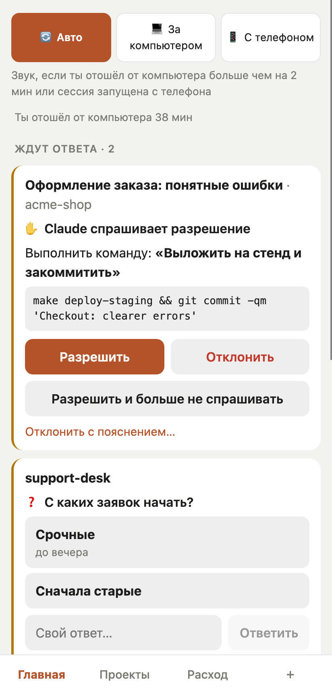
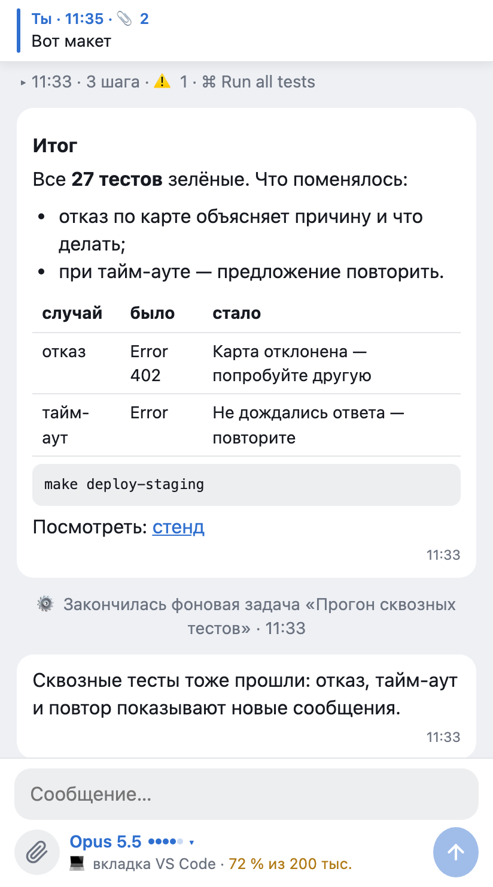
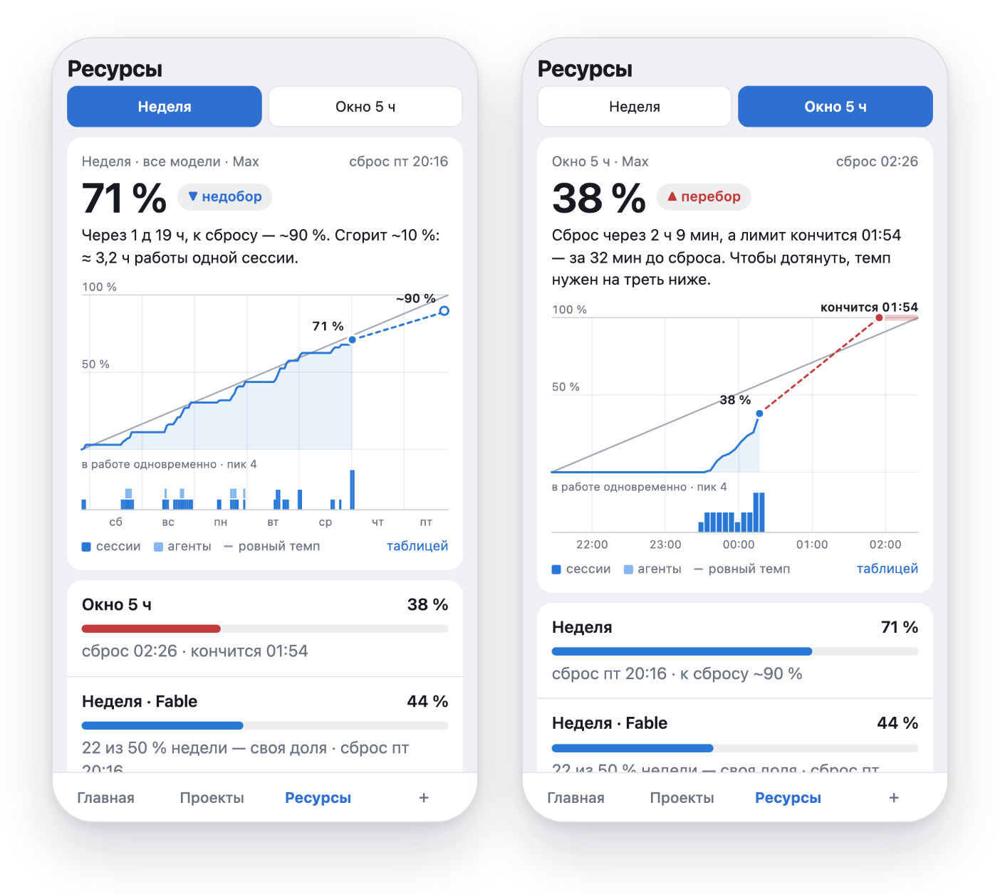

# Pult

**Пульт для сессий Claude Code на твоём Маке — в Telegram.**

[](https://github.com/pulthq/pult/actions/workflows/tests.yml)
&nbsp;MIT · macOS · английский и русский · [English](README.md)

Ты запускаешь Claude Code в VS Code или терминале и отходишь, а Мак продолжает работать: спрашивает разрешения,
задаёт вопросы, заканчивает задачи, пока тебя нет рядом. Пульт переносит каждую сессию Claude Code на Маке в
группу Telegram, по теме на проект. В теме видно ход, пока он идёт, итог, а вопросы и запросы разрешений Claude
приходят с кнопками. С телефона можно ответить, продолжить сессию, начать новую или написать прямо в уже открытую
вкладку VS Code.

<p align="center">
  
  
  
</p>
<p align="center"><sub>Веб-приложение внутри Telegram (по желанию). Выдуманные сессии со стенда.</sub></p>

## Что умеет

- **Все сессии сами.** Вкладки VS Code и сессии в терминале появляются в теме своего проекта через хуки
  Claude Code. Для каждой сессии ничего запускать не нужно.
- **Ход — одно живое сообщение:** сколько идёт и что Claude делает сейчас. Итог приходит отдельным сообщением:
  ```
  Оформление заказа: понятные ошибки · работает 6 мин
  Ты: «Сделай сообщения об ошибках при оплате понятнее»

  💬 Выкладываю на стенд и проверяю там страницу оплаты.
  ```
- **Разрешения и вопросы — кнопками.** Окно на Маке остаётся открытым, решает тот, кто ответил первым.
  ```
  ✋ Оформление заказа: понятные ошибки · Claude спрашивает разрешение
  Выполнить команду: «Выложить на стенд и закоммитить»
  make deploy-staging && git commit -qm 'Checkout: clearer errors'
  [✅ Разрешить]  [❌ Отклонить]  [♾ Разрешить и больше не спрашивать]
  ```
- **Отвечать.** Ответ на сообщение сессии продолжает её. Текст в теме проекта начинает новую сессию: сначала
  Пульт спросит, к какой сессии он относится. Текст, фото и файлы доходят до Claude: файлы сохраняются на Маке, и
  Claude получает путь к ним.
- **Прямо в открытую вкладку VS Code** (по желанию). Сообщение появляется во вкладке, будто набрано на Маке, и
  ход идёт там.
- **Режимы уведомлений.** 🔄 Авто — со звуком, если ты отошёл от компьютера больше чем на 2 минуты. 💻 За
  компьютером — всё беззвучно. 📱 С телефоном — всегда со звуком. Переключаются в одно касание в закреплённой
  панели или командами `/desk`, `/phone`, `/auto`.
- **Напоминания и предупреждения.** Напоминание приходит, когда ход идёт 10, 30 или 60 минут. Предупреждение —
  когда расход подписки доходит до 80 % и 95 %.
- **Любая долгая команда, не только Claude.** `pult run -- npm run build` сообщает о старте, ходе, коде выхода и
  хвосте вывода.
- **Веб-приложение** (по желанию, на своём сервере) — Mini App в Telegram. В нём все сессии целиком и вживую,
  лимиты подписки, токены за сегодня по проектам и форма новой задачи.

## Чем отличается от официальных способов

У Anthropic есть свои способы дотянуться до Claude Code не из-за клавиатуры. Если они подходят — пользуйся ими:

- **[Remote Control](https://code.claude.com/docs/en/remote-control)** подключает claude.ai/code или приложение
  Claude для iOS и Android к сессии Claude Code, которая идёт на твоём компьютере.
- **[Channels](https://code.claude.com/docs/en/channels)** (исследовательская версия) позволяют серверу MCP, в том
  числе готовым плагинам для Telegram, Discord и iMessage, присылать сообщения в идущую сессию Claude Code.

Пульт сделан под другой уклад:

- **Telegram — место, куда приходит всё.** Приложение Claude не нужно.
- **Все сессии Мака сразу, ничего не запуская.** Хуки подхватывают каждую вкладку VS Code и сессию в терминале,
  в том числе открытые до того, как ты ушёл.
- **Одна группа, тема на проект** — с историей ходов, итогов и решений.
- **Запись в уже открытую вкладку** VS Code, а не только в сессии, запущенные для работы издалека.
- **Всё работает на твоём Маке.** Из внешних служб — только Telegram (и твой сервер, если нужно веб-приложение).

## Что нужно

- macOS. Проверено на macOS 26 (Apple Silicon).
- Claude Code, вход выполнен: расширение VS Code, CLI или оба. Проверено с расширением 2.1.301 и Agent SDK 0.2.167.
- Python 3.10 или новее. Через Homebrew: `brew install python@3.12`.
- Telegram и свой бот (создаётся в @BotFather, мастер подскажет).
- По желанию, для веб-приложения: Linux-сервер с доменом и HTTPS.

## Установка (минут 10)

```
git clone https://github.com/pulthq/pult.git
cd pult
./install.sh
```

Установщик создаёт своё окружение Python в `~/.local/share/pult`, кладёт команду `pult` в `~/.local/bin` и
добавляет фоновую службу (launchd). Дальше мастер проходит четыре шага:

1. **Бот.** В Telegram открой @BotFather → `/newbot` и вставь токен, который он пришлёт.
2. **Ты.** Открой на телефоне ссылку, которую покажет мастер, и нажми **«Старт»**. Пульт узнает твой ID в
   Telegram и язык.
3. **Группа.** Создай группу и включи **«Темы»**. Добавь бота администратором с правами **«Управление темами»**
   и **«Закрепление сообщений»**, затем напиши в группе `/bind@твой_бот`. Мастер всё это проверит и скажет, чего
   не хватает.
4. **Хуки.** Пульт добавит свои хуки в `~/.claude/settings.json`. Остальные настройки не меняются, сначала
   делается копия.

Затем в VS Code: Cmd+Shift+P → **Developer: Reload Window**, чтобы открытые вкладки подхватили хуки. `pult setup`
можно запустить снова в любой момент — сменить бота, владельца или группу.

По желанию:

- `pult tab setup` — писать из Telegram прямо в открытые вкладки VS Code. Команда напечатает одну строку для
  настроек VS Code.
- `pult app` — веб-приложение. Нужен свой сервер: см. [deploy/relay/README.md](deploy/relay/README.md)
  (по-английски).

## Как пользоваться

Работай на Маке как обычно. В Telegram:

| | |
|---|---|
| тема проекта | ходы, итоги, вопросы и запросы разрешений его сессий |
| ответ на сообщение сессии | продолжить эту сессию |
| текст в теме проекта | спросит, к какой сессии он, или начнёт новую |
| `/new текст` | новая сессия в проекте этой темы, без вопросов |
| `/desk` `/phone` `/auto` `/mode` | режим уведомлений |
| `/status` | что сейчас открыто на Маке |
| `/projects`, `/sessions` | проекты и их темы; последние сессии этого проекта |
| `/stop` (ответом) | прервать ход сессии, запущенной из Telegram |
| `/app` | открыть веб-приложение |
| `/help` | всё это, по разделам |

В Терминале `pult help` перечислит команды: `status`, `setup`, `start|stop|restart`, `hooks on|off`, `tab …`,
`app`, `run`, `report`, `uninstall`.

## Как устроено

```
вкладки VS Code, терминал ──хуки──► pult_hook.py ──unix-сокет──► pultd (твой Мак, launchd) ──► Telegram Bot API
                                                                   │
Telegram на телефоне ──────────────────────────────────────────►  ├──Agent SDK──► Claude Code (сессии из Telegram)
                                                                   ├──► обёртка вкладки ──► открытая вкладка VS Code
веб-приложение (по желанию): Mini App ──► посредник на твоём сервере ◄── pultd подключается сам, портов на Маке нет
```

- **Хуки** (`SessionStart`, `UserPromptSubmit`, `PostToolUse`, `Stop`, `SessionEnd`, `PermissionRequest`)
  передают демону каждое событие. Хук никогда не мешает: если демон не запущен или что-то пошло не так, он молча
  выходит, и Claude Code ведёт себя так, будто хука нет.
- **Разрешения.** Хук ждёт твоего ответа из Telegram, а окно на Маке остаётся открытым. Claude Code берёт первый
  ответ и пропускает поздний.
- **Сессии из Telegram** идут через Claude Agent SDK. Это твой Claude Code: в папке проекта, с твоими
  настройками и собственным системным промптом Claude Code. По умолчанию — режим разрешений Claude Code `auto`
  (`PULT_PERMISSION_MODE`). Всё, о чём Claude Code спрашивает, приходит в Telegram кнопками.
- **Запись в открытую вкладку** идёт через обёртку (`claudeCode.claudeProcessWrapper`) между VS Code и Claude
  Code, тоже по желанию. Она передаёт всё байт в байт и добавляет твоё сообщение во вход вкладки. Работает только
  на тех версиях Claude Code, на которых её проверили; в любом другом случае запускает Claude Code напрямую.
- **Честная оговорка.** Часть этого держится на внутренностях Claude Code: на содержимом событий хуков и на
  потоке сообщений вкладки. Когда расширение Claude Code обновляется, Пульт выключает запись во вкладки до
  проверки новой версии и пишет об этом. До проверки сообщения в открытые вкладки уходят копией сессии.

## Безопасность и приватность

- **Кто может управлять твоим Маком.** Только аккаунты Telegram из `PULT_ALLOWED_USER_IDS` (то есть ты) и только
  в привязанной группе. Кто войдёт в твой Telegram, сможет запускать Claude Code на Маке с правами твоего
  пользователя — включи двухэтапную проверку в Telegram.
- **Токен бота — это ключ.** Он лежит в `~/.config/pult/env` (права 600). Если утёк — `/revoke` в @BotFather и
  `pult setup`.
- **Что уходит в Telegram:** твои запросы, ответы Claude (в чате — сокращённо), названия шагов, запросы
  разрешений (команды, имена файлов) и вопросы. Telegram хранит это в своём облаке, как любую переписку. Чаты с
  ботами не шифруются сквозным шифрованием.
- **Посредник веб-приложения** ничего не хранит. Чужих он отсекает по подписи Telegram и твоему ID. Мак ещё раз
  проверяет каждый вход ключом бота, а ключ бота Мак не покидает. Данные идут через твой сервер по TLS.
- **Никакой телеметрии.** Журналы остаются в `~/Library/Logs`. `pult report` печатает версии и состояние для
  сообщения об ошибке — без токенов, ID, имён папок и текста сообщений.
- **Уязвимости** — сообщай закрыто, см. [SECURITY.md](SECURITY.md).

## Claude Code, твоя подписка и Anthropic

У Пульта нет своего входа и своей модели. Он управляет Claude Code, который уже установлен и вошёл в аккаунт на
твоём Маке, — с твоим аккаунтом и лимитами твоей подписки, так же, как ты в терминале.
[Документация Agent SDK](https://code.claude.com/docs/en/agent-sdk/overview) говорит: *«Unless previously approved,
Anthropic does not allow third party developers to offer claude.ai login or rate limits for their products,
including agents built on the Claude Agent SDK»* (без согласования Anthropic не разрешает сторонним разработчикам
предлагать в своих продуктах вход через claude.ai или его лимиты). Пульт вход не предлагает: он запускает за тебя
твой собственный Claude Code. И всё же прочитай условия своей подписки и реши сам. Claude Code можно войти и с
ключом API Anthropic; с Пультом так пока не проверялось.

Pult — независимый проект с открытым кодом, не связан с Anthropic и не одобрен ею. Claude и Claude Code —
товарные знаки Anthropic.

## Выключить, удалить

- `pult hooks off`, затем Reload Window — Пульт перестаёт видеть сессии.
- `pult stop` — служба остановлена. `pult start` — запустить снова.
- `pult tab off` — новые вкладки VS Code запускаются без обёртки.
- `pult uninstall` — удаляет службу, хуки, команду `pult` и файлы Пульта и спрашивает, удалить ли и настройки с
  токеном бота. Бот и группа остаются в Telegram.

Без Пульта Claude Code работает ровно как раньше.

## Если что-то не так

| | |
|---|---|
| Бот молчит | `pult status` покажет службу и связь с Telegram. `pult restart`. Журнал — `~/Library/Logs/pult.log`. |
| Нет сессий из VS Code | Хуки выключены: `pult hooks on`, затем Reload Window. |
| В журнале `409` | Обновления этого бота читает другая программа, например вторая копия Пульта. |
| Кнопок разрешений нет, а лента есть | Режим `auto` в Claude Code решает сам. Это нормально. |
| Сообщение в открытую вкладку ушло копией | Вкладка открыта до настройки обёртки (поможет Reload Window) или только что обновилось расширение Claude Code (Пульт написал об этом в «Общую»). |
| Другое | `pult report`, затем [заведи issue](https://github.com/pulthq/pult/issues/new/choose). |

**Linux или Windows?** Пока нет. Следующим будет Linux, потом Windows: то, что завязано на macOS (launchd, пути
VS Code, определение простоя), переносится.

**Несколько человек?** Нет. У одного Пульта один владелец.

**Лишний расход?** Нет. Пульт тратит только то, что тратят сами сессии. Экран расхода узнаёт лимиты у Claude Code
без запроса к модели.

## Участие

Ошибки, идеи и pull request'ы — пожалуйста: [CONTRIBUTING.md](CONTRIBUTING.md) (по-английски). История изменений —
[CHANGELOG.md](CHANGELOG.md).

## Лицензия

[MIT](LICENSE)
