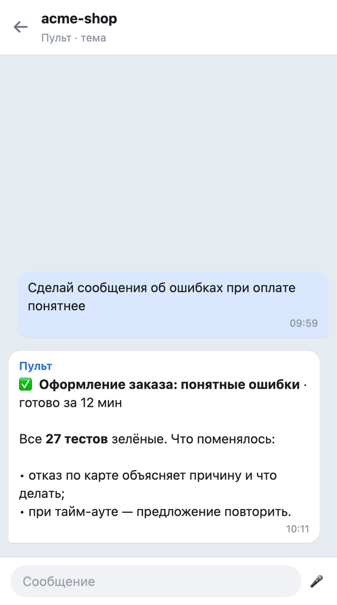
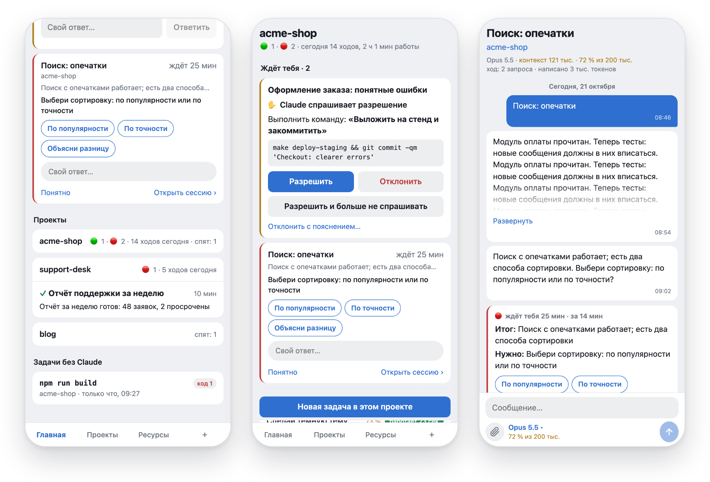

# Pult

**Видеть и вести каждую сессию Claude Code на своём компьютере — из Telegram.**

[](https://github.com/pulthq/pult/actions/workflows/tests.yml)
[](https://github.com/pulthq/pult/releases)
&nbsp;MIT · macOS и Linux · английский и русский · [English](README.md)

<p align="center">
  
  &nbsp;
  
</p>
<p align="center"><sub>Слева: тема проекта в Telegram. Справа: «Главная» веб-приложения — что ждёт тебя, с готовыми ответами, и живые сессии всех проектов. Выдуманные проекты, нарисовано из сообщений самого Пульта на стенде.</sub></p>

Ты даёшь Claude Code задачу в VS Code или терминале и отходишь. Claude продолжает, а потом останавливается, чтобы
задать вопрос или дождаться разрешения, и работа стоит, пока ты не вернёшься. Пульт переносит каждую сессию
Claude Code на компьютере в группу Telegram, по теме на проект. Телефон показывает, что Claude делает, звонит,
когда Claude нужен ты, и даёт ответить, продолжить сессию или начать новую. Пульт работает на твоём компьютере
и не открывает на нём ни одного порта.

```
git clone https://github.com/pulthq/pult.git && cd pult && ./install.sh
```

Установщик за десять минут проведёт через своего бота и группу в Telegram. macOS и Linux; Windows — следующим.
*Пульт* по-английски — remote control.

## Час с Пультом

1. **Ты запускаешь задачу** во вкладке VS Code и уходишь обедать. Ничего включать и регистрировать не нужно:
   Пульт уже видит все сессии на компьютере.
2. **В теме проекта ход идёт вживую.** Одно сообщение, которое обновляется, — `⏳ Оформление заказа: понятные
   ошибки · работает 6 мин` — а под ним то, что Claude делает сейчас, его же словами.
3. **Claude нужно выполнить команду.** Телефон звонит: `✋ Claude спрашивает разрешение`, команда целиком и кнопки
   **Разрешить** / **Отклонить**. Окно в VS Code тоже открыто; решает тот, кто ответил первым.
4. **Приходит итог:** `✅ Оформление заказа: понятные ошибки · готово за 12 мин` и выжимка от Claude.
5. **Ты отвечаешь с телефона.** «Теперь тесты» уходит в ту же сессию и появляется в открытой вкладке VS Code,
   будто ты набрал это там. `/new …` начинает ещё одну сессию в том же проекте.
6. **Вернулся к компьютеру** — всё, что ты делал с телефона, уже во вкладке, а история осталась в теме.

## Что умеет

- **Все сессии сами.** Вкладки VS Code и сессии в терминале появляются в теме своего проекта через хуки
  Claude Code, в том числе открытые до того, как ты ушёл.
- **Только то, что нужно человеку.** Ход одним живым сообщением, итог, вопросы и запросы разрешений Claude
  с кнопками. Ни номеров сессий, ни путей, ни названий инструментов в чате.
- **Отвечать.** Ответ на сообщение продолжает эту сессию; текст в теме идёт в текущую сессию темы; `/new`
  начинает новую. Фото и файлы тоже доходят до Claude, из чата или по скрепке в приложении: они сохраняются на
  компьютере, и Claude получает путь.
- **Говорить вместо того, чтобы печатать.** Голосовое в теме распознаётся и идёт дальше как набранный текст;
  в приложении микрофон рядом со скрепкой кладёт слова в поле ввода. Распознаёт Groq (Whisper) по твоему бесплатному
  ключу — задаётся в «Настройки → Голосовой ввод» приложения или командой `pult stt`; записи нигде не хранятся.
  Без ключа ничего не меняется.
- **Прямо в открытую вкладку VS Code** (по желанию). Сообщение появляется во вкладке, будто набрано там, и ход
  идёт в ней. Если Claude в этой вкладке занят, сообщение доходит до него посреди хода: во вкладке оно отдельно
  не показывается, а ответ приходит вместе с итогом этого хода — ответом на твоё сообщение.
- **Модель и раздумья с телефона.** Fable, Opus, Sonnet или Haiku и то, насколько глубоко Claude думает, — для одной
  сессии: идущая переключается сразу, открытая вкладка VS Code тоже, настройки Claude Code не трогаются.
- **Уведомления, которые знают, где ты.** 🔄 Авто — звук только если ты отошёл от компьютера больше чем на 2
  минуты. 💻 За компьютером — всё беззвучно; 📱 С телефоном — всегда со звуком. Одно касание в закреплённой
  панели или `/desk`, `/phone`, `/auto`.
- **Напоминания и предупреждения.** Напоминание, когда ход идёт 10, 30 или 60 минут; предупреждение, когда
  расход подписки доходит до 80 % и 95 %.
- **Любая долгая команда, не только Claude.** `pult run -- npm run build` сообщает о старте, ходе, коде выхода и
  хвосте вывода.
- **Два языка.** Бот и приложение говорят по-английски и по-русски; язык берётся из твоего Telegram.

## Веб-приложение (по желанию)

Mini App в Telegram на своём сервере, в одном касании из любой темы. С телефона в нём работать удобнее всего:

- **Главная** строится вокруг того, чей ход. Сверху — **Твой ход**: запросы разрешений и вопросы Claude, на которые
  отвечаешь прямо там, и сессии, которые закончили и ждут тебя, дольше ждёт — выше, с **готовыми ответами** из текста
  самого Claude (одно нажатие, три секунды на отмену) и полем для своих слов. Ниже — **Проекты**: кто работает и кто
  ждёт, ходы за сегодня, по строке на живую сессию. По желанию маленькая модель (haiku, по твоей подписке) пишет эти
  строки простыми словами и подбирает ответы. После перерыва — **Пока тебя не было**: что прошло без тебя. Каждая
  метка ведёт к причине: красная точка у проекта открывает его доску с тем, что ждёт, наверху; сессия открывается на итоге.
- **Telegram становится пейджером**, когда приложение настроено: зовёт, только когда Claude ждёт тебя, а ты не в
  приложении и не за компьютером (или на твои сообщения в теме), с готовыми ответами кнопками. Увидел где угодно —
  сообщение сворачивается. Ход, упёршийся в лимит, предлагает продолжить сразу после сброса.
- **Сессия** — вся переписка, вживую. Когда листаешь вверх, твоё сообщение закреплено сверху, а ранняя история
  подгружается сама. Под полем ввода — модель с раздумьями пятью точками (нажатие открывает меню), куда уйдёт
  сообщение и шкала контекста как в VS Code. Скрепка отправляет Claude снимок экрана; микрофон превращает голос
  в слова в поле.
- **Ресурсы** — лимиты подписки, токены за сегодня по проектам, нагрузка на компьютер и состояние Пульта. Форма
  начинает новую задачу в любом проекте.

<p align="center">
  
</p>

Нужен Linux-сервер с доменом и HTTPS: см. [deploy/relay/README.md](deploy/relay/README.md) (по-английски).
Без него всё перечисленное выше работает в чате.

## Чем отличается от официальных способов

У Anthropic есть свои способы дотянуться до Claude Code не из-за клавиатуры. Если они подходят — пользуйся ими.

| | Пульт | [Remote Control](https://code.claude.com/docs/en/remote-control) | [Channels](https://code.claude.com/docs/en/channels) |
|---|---|---|---|
| Где отвечаешь | Telegram, плюс веб-приложение внутри него по желанию | claude.ai/code или приложение Claude | Telegram, Discord или iMessage |
| Какие сессии | каждая вкладка VS Code и сессия в терминале, через хуки | те, что подключишь, или все — с его настройкой автоподключения | сессия, запущенная как `claude --channels …` |
| Вход | любой, с которым работает Claude Code | подписка claude.ai; ключи API не поддерживаются | claude.ai или ключ API Console |
| Статус | независимый, открытый код | официальный | официальный, исследовательская версия |

Что Пульт даёт сверх доступа к сессии:

- **Одна группа Telegram с темой на проект** — с историей ходов, итогов и решений.
- **Уведомления, которые знают, где ты**, напоминания о долгих ходах и предупреждения на 80 % и 95 % подписки.
- **Свои долгие команды** сообщаются так же: `pult run -- npm run build`.
- **Ничего не нужно запускать для каждой сессии**, и приложение Claude не нужно: оно доступно не во всех странах.

## Что нужно

- macOS или Linux. Проверено на macOS 26 (Apple Silicon) и Ubuntu 24.04 (arm64).
- Claude Code, вход выполнен: расширение VS Code, CLI или оба. Проверено с расширением 2.1.301 и Agent SDK 0.2.167.
- Python 3.10 или новее. На Маке через Homebrew: `brew install python@3.12`. В Debian или Ubuntu:
  `sudo apt update && sudo apt install python3 python3-venv`.
- Telegram и свой бот (создаётся в @BotFather, мастер подскажет).
- По желанию, для веб-приложения: Linux-сервер с доменом и HTTPS.

## Установка (минут 10)

```
git clone https://github.com/pulthq/pult.git
cd pult
./install.sh
```

Установщик создаёт своё окружение Python в `~/.local/share/pult`, кладёт команду `pult` в `~/.local/bin` и
добавляет фоновую службу (launchd на macOS, служба systemd пользователя на Linux). Дальше мастер проходит четыре шага:

1. **Бот.** В Telegram открой @BotFather → `/newbot` и вставь токен, который он пришлёт.
2. **Ты.** Открой на телефоне ссылку, которую покажет мастер, и нажми **«Старт»**. Пульт узнает твой ID в
   Telegram и язык.
3. **Группа.** Создай группу и включи **«Темы»**. Добавь бота администратором с правами **«Управление темами»**
   и **«Закрепление сообщений»**, затем напиши в группе `/bind@твой_бот`. Мастер всё это проверит и скажет, чего
   не хватает.
4. **Хуки.** Пульт добавит свои хуки в `~/.claude/settings.json`. Остальные настройки не меняются, сначала
   делается копия.

Затем в VS Code: Cmd+Shift+P (Ctrl+Shift+P на Linux) → **Developer: Reload Window**, чтобы открытые вкладки
подхватили хуки. `pult setup` можно запустить снова в любой момент — сменить бота, владельца или группу.

По желанию:

- `pult tab setup` — писать из Telegram прямо в открытые вкладки VS Code. Команда напечатает одну строку для
  настроек VS Code.
- `pult app` — веб-приложение. Нужен свой сервер: см. [deploy/relay/README.md](deploy/relay/README.md)
  (по-английски).

<details>
<summary><b>На Linux</b></summary>

Пульт ставится туда, где работает Claude Code:

- **Linux-компьютер с VS Code или терминалом** — так же, как на Маке.
- **Сервер, который ты открываешь в VS Code через Remote-SSH**: Claude Code работает на сервере, поэтому и Пульт —
  туда. Строка из `pult tab setup` идёт в настройки сервера: в окне, подключённом к нему, Ctrl+Shift+P →
  **Preferences: Open Remote Settings (JSON)**.
- **Claude Code в терминале на сервере, по SSH** — сессии, разрешения и вопросы приходят в Telegram так же.

На сервере службы пользователя останавливаются, когда он выходит. Чтобы Пульт работал всегда и сам запускался при
загрузке: `sudo loginctl enable-linger $USER` (установщик напомнит).

Отошёл ли ты от компьютера (звук в 🔄 Авто), Пульт узнаёт у GNOME, KDE или X11. В остальных случаях (сервер,
другой рабочий стол) — по твоим действиям в сессиях: набранный запрос или ответ на разрешение за последние две
минуты.

</details>

## Как пользоваться

Работай на компьютере как обычно. В Telegram:

| | |
|---|---|
| тема проекта | ходы, итоги, вопросы и запросы разрешений его сессий |
| ответ на сообщение сессии | продолжить эту сессию |
| текст в теме проекта | в текущую сессию темы (🎯 в закрепе); нет её — в единственную открытую, иначе спросит один раз |
| `/new текст` или `/new`, а потом текст | новая сессия в проекте этой темы |
| `/desk` `/phone` `/auto` `/mode` | режим уведомлений |
| `/status` | что сейчас открыто на компьютере |
| `/projects`, `/sessions` | проекты и их темы; последние сессии этого проекта |
| `/stop` | прервать текущую сессию темы, запущенную из Telegram; ответом — ту сессию |
| `/app`, «📱 Пульт» в закрепе темы | открыть веб-приложение (из темы — на этом проекте) |
| `/help` | всё это, по разделам |

В терминале `pult help` перечислит команды: `status`, `setup`, `start|stop|restart`, `hooks on|off`, `tab …`,
`app`, `stt`, `run`, `report`, `uninstall`.

## Как устроено

```
вкладки VS Code, терминал ──хуки──► pult_hook.py ──unix-сокет──► pultd (твой компьютер) ────► Telegram Bot API
                                                                   │
Telegram на телефоне ──────────────────────────────────────────►  ├──Agent SDK──► Claude Code (сессии из Telegram)
                                                                   ├──► обёртка вкладки ──► открытая вкладка VS Code
веб-приложение (по желанию): Mini App ──► посредник на твоём сервере ◄── pultd подключается сам, портов на компьютере нет
```

- **Хуки** (`SessionStart`, `UserPromptSubmit`, `PostToolUse`, `PostToolUseFailure`, `Stop`, `StopFailure`,
  `SessionEnd`, `PermissionRequest`) передают демону каждое событие. Хук никогда не мешает: если демон не запущен или что-то
  пошло не так, он молча выходит, и Claude Code ведёт себя так, будто хука нет.
- **Разрешения.** Хук ждёт твоего ответа из Telegram, а окно на компьютере остаётся открытым. Claude Code берёт
  первый ответ и пропускает поздний.
- **Сессии из Telegram** идут через Claude Agent SDK. Это твой Claude Code: в папке проекта, с твоими
  настройками и собственным системным промптом Claude Code. По умолчанию — режим разрешений Claude Code `auto`
  (`PULT_PERMISSION_MODE`). Всё, о чём Claude Code спрашивает, приходит в Telegram кнопками.
- **Запись в открытую вкладку** идёт через обёртку (`claudeCode.claudeProcessWrapper`) между VS Code и Claude
  Code, тоже по желанию. Она передаёт всё байт в байт и добавляет твоё сообщение во вход вкладки. Работает только
  на тех версиях Claude Code, на которых её проверили; в любом другом случае запускает Claude Code напрямую.
- **Честная оговорка.** Часть этого держится на внутренностях Claude Code: на содержимом событий хуков и на
  потоке сообщений вкладки. Когда расширение Claude Code обновляется, Пульт выключает запись во вкладки до
  проверки новой версии и пишет об этом. До проверки сообщения в открытые вкладки уходят копией сессии.

## Безопасность и приватность

- **Кто может управлять твоим компьютером.** Только аккаунты Telegram из `PULT_ALLOWED_USER_IDS` (то есть ты) и только
  в привязанной группе. Кто войдёт в твой Telegram, сможет запускать Claude Code на компьютере с правами
  твоего пользователя — включи двухэтапную проверку в Telegram.
- **Токен бота — это ключ.** Он лежит в `~/.config/pult/env` (права 600). Если утёк — `/revoke` в @BotFather и
  `pult setup`.
- **Что уходит в Telegram:** твои запросы, ответы Claude (в чате — сокращённо), названия шагов, запросы
  разрешений (команды, имена файлов) и вопросы. Telegram хранит это в своём облаке, как любую переписку. Чаты с
  ботами не шифруются сквозным шифрованием.
- **Посредник веб-приложения** ничего не хранит. Чужих он отсекает по подписи Telegram и твоему ID. Компьютер ещё
  раз проверяет каждый вход ключом бота, а ключ бота его не покидает. Для нового входа нужны данные входа, которые
  Telegram выдал несколько минут назад, а для переподключения — одноразовый ключ, который компьютер дал этому окну.
  Страница приложения запускает скрипты только с твоего сервера и Telegram (Content-Security-Policy). Данные идут через
  твой сервер по TLS.
- **Тревоги.** Пульт сообщает со звуком о входе в приложение из новой сети и о признаках того, что токен бота есть у
  кого-то ещё (второй читатель бота, вебхук, подменённая кнопка приложения). В приложении «Настройки → Входы»
  показывают последние входы и закрывают все окна.
- **Ссылки показывают, куда ведут:** если текст ссылки не показывает её адрес, домен стоит рядом в скобках — Claude
  может написать ссылку, которую ему подсунула страница, а придёт она от твоего же бота.
- **Никакой телеметрии.** Журналы остаются на компьютере: `~/Library/Logs` на macOS, `~/.local/state/pult` на
  Linux. `pult report` печатает версии и состояние для сообщения об ошибке — без токенов, ID, имён папок и текста
  сообщений.
- **Уязвимости** — сообщай закрыто, см. [SECURITY.md](SECURITY.md).

## Claude Code, твоя подписка и Anthropic

У Пульта нет своего входа и своей модели. Он управляет Claude Code, который уже установлен и вошёл в аккаунт на
твоём компьютере, — с твоим аккаунтом и лимитами твоей подписки, так же, как ты в терминале.
[Документация Agent SDK](https://code.claude.com/docs/en/agent-sdk/overview) говорит: *«Unless previously approved,
Anthropic does not allow third party developers to offer claude.ai login or rate limits for their products,
including agents built on the Claude Agent SDK»* (без согласования Anthropic не разрешает сторонним разработчикам
предлагать в своих продуктах вход через claude.ai или его лимиты). Пульт вход не предлагает: он запускает за тебя
твой собственный Claude Code. И всё же прочитай условия своей подписки и реши сам. Claude Code можно войти и с
ключом API Anthropic; с Пультом так пока не проверялось.

Pult — независимый проект с открытым кодом, не связан с Anthropic и не одобрен ею. Claude и Claude Code —
товарные знаки Anthropic.

## Выключить, удалить

- `pult hooks off`, затем Reload Window — Пульт перестаёт видеть сессии.
- `pult stop` — служба остановлена. `pult start` — запустить снова.
- `pult tab off` — новые вкладки VS Code запускаются без обёртки.
- `pult uninstall` — удаляет службу, хуки, команду `pult` и файлы Пульта и спрашивает, удалить ли и настройки с
  токеном бота. Бот и группа остаются в Telegram.

Без Пульта Claude Code работает ровно как раньше.

## Если что-то не так

<details>
<summary>Когда что-то не работает</summary>

| | |
|---|---|
| Бот молчит | `pult status` покажет службу и связь с Telegram. `pult restart`. Журнал — `~/Library/Logs/pult.log` на macOS, `~/.local/state/pult/pult.log` на Linux. |
| Linux: Пульт останавливается, когда выходишь | `sudo loginctl enable-linger $USER`. |
| Нет сессий из VS Code | Хуки выключены: `pult hooks on`, затем Reload Window. |
| В журнале `409` | Обновления этого бота читает другая программа, например вторая копия Пульта. |
| Кнопок разрешений нет, а лента есть | Режим `auto` в Claude Code решает сам. Это нормально. |
| Сообщение в открытую вкладку ушло копией | Вкладка открыта до настройки обёртки (поможет Reload Window) или только что обновилось расширение Claude Code (Пульт написал об этом в «Общую»). |
| Другое | `pult report`, затем [заведи issue](https://github.com/pulthq/pult/issues/new/choose). |

</details>

**Windows?** Пока нет: будет следующим.

**Несколько человек?** Нет. У одного Пульта один владелец.

**Лишний расход?** Нет. Пульт тратит только то, что тратят сами сессии. Экран расхода узнаёт лимиты у Claude Code
без запроса к модели.

## Участие

Ошибки, идеи и pull request'ы — пожалуйста: [CONTRIBUTING.md](CONTRIBUTING.md) (по-английски). История изменений —
[CHANGELOG.md](CHANGELOG.md).

## Лицензия

[MIT](LICENSE)
