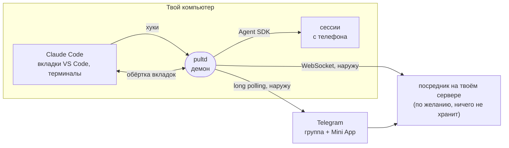

# Pult

**Видеть и вести каждую сессию Claude Code на своём компьютере — из Telegram.**

[](https://github.com/pulthq/pult/actions/workflows/tests.yml)
[](https://github.com/pulthq/pult/releases)
&nbsp;MIT · macOS, Linux и Windows · английский и русский · [English](README.md)

<p align="center">
  
  &nbsp;
  
</p>
<p align="center"><sub>Слева: тема проекта в Telegram. Справа: «Главная» веб-приложения. Выдуманные проекты, нарисовано из сообщений самого Пульта на стенде.</sub></p>

Ты даёшь Claude Code задачу и отходишь. Claude останавливается, чтобы задать вопрос или дождаться разрешения, и
работа стоит, пока ты не вернёшься. **Пульт** переносит каждую сессию Claude Code на компьютере в группу Telegram,
по теме на проект: телефон показывает, что Claude делает, звонит, только когда нужен ты, и даёт ответить,
продолжить или начать сессию — а сделанное с телефона видно в открытой вкладке VS Code. Пульт работает на твоём
компьютере и не открывает на нём портов в сеть.

```
git clone https://github.com/pulthq/pult.git && cd pult && ./install.sh
```

Минут десять вместе со своим ботом в Telegram; на Windows установщик — `install.ps1`. *Пульт* по-английски —
remote control.

## Что даёт

| | |
|---|---|
| **Все сессии, ничего не запускать** | Вкладки VS Code и сессии в терминале появляются в теме своего проекта через хуки Claude Code — и те, что ты открыл до ухода. |
| **Отвечать откуда угодно** | Запросы разрешений и вопросы Claude приходят с кнопками. Окно на компьютере тоже открыто: решает ответ, пришедший первым. |
| **Писать в ответ — и в открытую вкладку** | Ответ продолжает ту сессию, `/new` начинает новую. С обёрткой вкладок (по желанию) сообщение появляется во вкладке VS Code, будто набрано там. Снимки и файлы тоже доходят до Claude; голосовые превращаются в текст с бесплатным ключом Groq. |
| **Файлы в обе стороны** | Перешли в тему проекта документы, презентации или картинки — они лягут в `inbox/<дата>/` проекта под своими именами, альбом уйдёт одним сообщением, а файлы без слов подождут следующего. Попроси результат — Claude пришлёт его в тему командой `pult send`: только файлы этого проекта, ничего похожего на ключи. |
| **Модель и раздумья** | Fable, Opus, Sonnet или Haiku и насколько глубоко Claude думает — для одной сессии; идущая переключается сразу. |
| **Темп расхода подписки** | Каждый лимит — неделя и окно 5 ч — кривой против ровного темпа, с прогнозом: в темпе, недобор (сколько часов работы сессии сгорит) или перебор (когда кончится). Под кривой — сколько сессий работало одновременно. |
| **Звонит, только когда важно** | С веб-приложением Telegram становится пейджером: звонит, когда Claude ждёт тебя, а тебя нет ни в приложении, ни за компьютером. Напоминания о долгих ходах, предупреждения на 80 % и 95 % лимита. |
| **Свои долгие команды** | `pult run -- npm run build` сообщает о начале, ходе и коде выхода так же. |

## Веб-приложение (по желанию)

Mini App в Telegram на твоём небольшом сервере, в одно нажатие из любой темы, — удобный способ работать с телефона:

- **«Главная»** построена вокруг того, чей ход: что идёт сейчас, ниже — что ждёт тебя: запросы разрешений с
  ответом прямо там, закончившие сессии, которым нужен ты, с готовыми ответами из сообщения самого Claude.
- **Сессия** — вся переписка вживую; под полем ввода — модель, раздумья и шкала контекста.
- **«Ресурсы»** — как ты тратишь подписку: кривая каждого лимита, прогноз, кто съел, и нагрузка на компьютер.
- **Файлы хода**: что Claude создал или изменил в проекте — отметь нужные и отправь в тему проекта по одному или одним
  архивом; файлы прошлых ходов — в соседних.
- **Новый проект** с телефона: папка где угодно в домашней — пустая с git, с `CLAUDE.md`, который Claude напишет по
  твоему описанию, или клон репозитория. Тема проекта сразу появляется в группе.

<p align="center">
  
</p>
<p align="center">
  
</p>

Нужен Linux-сервер с доменом и HTTPS: [deploy/relay/README.md](deploy/relay/README.md). Без него всё остальное
работает в одном чате.

## Как устроено



- **Хуки** передают демону события каждой сессии. Если демон не запущен, хук тихо выходит, и Claude Code ведёт
  себя так, будто Пульта нет.
- **Запрос разрешения** идёт наперегонки с окном на компьютере: Claude Code берёт первый ответ и не замечает
  поздний, поэтому ничего не зависает.
- **Сессии с телефона** — твой же Claude Code через Agent SDK: папка проекта, твои настройки, системный промпт
  самого Claude Code.
- **Запись в открытую вкладку** идёт через обёртку процесса (по желанию), которая передаёт всё байт в байт. Она
  работает только на проверенных версиях Claude Code; на новой выключается сама и говорит об этом.
- **Кривая расхода** проходит через собственные показания Claude Code о лимитах, а её форма между ними — по токенам
  из твоих транскриптов.

Подробно, со схемой каждого пути: **[ARCHITECTURE.ru.md](ARCHITECTURE.ru.md)**.

## Чем отличается от официальных способов

У Anthropic есть свои способы дотянуться до Claude Code не из-за клавиатуры. Если они подходят — пользуйся ими.

| | Пульт | [Remote Control](https://code.claude.com/docs/en/remote-control) | [Channels](https://code.claude.com/docs/en/channels) |
|---|---|---|---|
| Где отвечаешь | Telegram, плюс веб-приложение внутри него по желанию | claude.ai/code или приложение Claude | Telegram, Discord или iMessage |
| Какие сессии | каждая вкладка VS Code и сессия в терминале, через хуки | те, что подключишь, или все — с его настройкой автоподключения | сессия, запущенная как `claude --channels …` |
| Вход | любой, с которым работает Claude Code | подписка claude.ai; ключи API не поддерживаются | claude.ai или ключ API Console |
| Статус | независимый, открытый код | официальный | официальный, исследовательская версия |

Сверх доступа к сессии Пульт держит одну группу с темой на проект и её историей, знает, где ты, прежде чем
звонить, показывает темп расхода подписки и не требует приложения Claude, которое доступно не во всех странах.

## Что нужно

- macOS, Linux или Windows; проверено на macOS 26 (Apple Silicon), Ubuntu 24.04 (arm64) и Windows 11 (x64).
- Claude Code со входом: расширение VS Code, CLI или оба. Проверено с расширением 2.1.301 (на Windows — 2.1.306) и
  Agent SDK 0.2.167.
- Python 3.10+: `brew install python@3.12`, `sudo apt install python3 python3-venv`, а на Windows —
  [python.org](https://www.python.org/downloads/windows/) или `winget install Python.Python.3.12` (не из Microsoft
  Store).
- Telegram и свой бот из @BotFather; установка проведёт.

## Установка

```
git clone https://github.com/pulthq/pult.git
cd pult
./install.sh
```

Установщик создаёт своё окружение Python в `~/.local/share/pult`, кладёт команду `pult` в `~/.local/bin` и
добавляет фоновую службу (launchd на macOS, пользовательская служба systemd на Linux). Затем мастер:

1. **Бот.** В @BotFather: `/newbot`, вставь токен.
2. **Ты.** Открой показанную ссылку на телефоне и нажми **Start**: Пульт узнает твой ID и язык.
3. **Группа.** Создай группу с включёнными **Темами**, добавь бота админом с правами **Управлять темами** и
   **Закреплять сообщения**, отправь туда `/bind@твой_бот`. Мастер проверит и скажет, чего не хватает.
4. **Хуки.** Пульт добавляет свои хуки в `~/.claude/settings.json`, сохраняя остальные настройки и резервную копию.

Потом в VS Code — **Developer: Reload Window**, чтобы открытые вкладки подхватили хуки. По желанию: `pult tab setup`
(запись в открытые вкладки: одна строка в настройки VS Code), `pult app` (веб-приложение), `pult stt` (голос,
бесплатный ключ Groq).

<details>
<summary><b>На Linux</b></summary>

- **Рабочий стол с VS Code или терминалом:** так же, как на Маке.
- **Сервер, открытый в VS Code через Remote-SSH:** Claude Code работает на сервере, значит Пульт ставится туда;
  строка из `pult tab setup` — в настройки сервера (**Preferences: Open Remote Settings (JSON)**).
- **Claude Code в терминале по SSH:** сессии, разрешения и вопросы приходят в Telegram так же.
- Службы пользователя останавливаются, когда он выходит: `sudo loginctl enable-linger $USER` оставит Пульт
  работать и запустит при загрузке (установщик напомнит).
- «Отошёл ли ты» Пульт узнаёт у GNOME, KDE или X11; в остальных случаях — по тому, что ты делаешь в сессиях.

</details>

<details>
<summary><b>На Windows</b></summary>

Возьми Пульт через `git clone` или ZIP из [Releases](https://github.com/pulthq/pult/releases), затем в PowerShell,
в его папке:

```
powershell -ExecutionPolicy Bypass -File install.ps1
```

- **Python** ищется через `py`; из Microsoft Store не подойдёт — он работает в песочнице.
- **Служба** — задание планировщика «Pult», запускается при входе в Windows, без прав администратора.
- **Команда `pult`** ложится в `~\.local\bin`, папка добавляется в PATH: после установки открой новый терминал.
- **Окон консоли нет:** хуки и обёртка вкладок (`pult-tab.exe`) работают без них.
- **Строка обёртки** из `pult tab setup` удваивает каждую обратную косую черту, как требует JSON. Если VS Code пишет
  «Claude Code native binary not found at C:sers…», строка потеряла их: `pult status` покажет правильную.
- **Без Git Bash** Claude Code выполняет команды через PowerShell; запросы разрешений приходят так же.
- **За VPN** сразу после входа Telegram может быть недоступен; Пульт его дождётся.
- **На Windows пока нет** нагрузки на компьютер в «Ресурсах». Журнал — `~\.local\state\pult\pult.log`.

</details>

## Как пользоваться

| В Telegram | |
|---|---|
| тема проекта | ходы, итоги, вопросы и запросы разрешений его сессий |
| ответ на сообщение сессии | продолжить эту сессию |
| текст в теме | текущая сессия темы (🎯 в закреплённой карточке); нет её — единственная открытая, иначе Пульт спросит один раз |
| `/new текст` или `/new`, потом текст | новая сессия в этом проекте |
| `/desk` `/phone` `/auto` `/mode` | где ты: тихо за компьютером, всегда со звуком или со звуком после 2 минут без тебя |
| `/status`, `/projects`, `/sessions` | что открыто сейчас; проекты; недавние сессии этого проекта |
| `/stop` | прервать текущую сессию темы, запущенную из Telegram |
| `/app`, 📱 Pult в закрепе темы | открыть веб-приложение |

В терминале — `pult help`: `status`, `setup`, `start|stop|restart`, `busy`, `hooks on|off`, `tab …`, `app`, `stt`,
`run`, `report`, `uninstall`.

## Безопасность и приватность

- **Кто может управлять компьютером:** только твой аккаунт Telegram (`PULT_ALLOWED_USER_IDS`) и только в привязанной
  группе. Тот, кто попадёт в твой Telegram, сможет запускать Claude Code с правами твоего пользователя: включи
  двухэтапную проверку.
- **Токен бота — это ключ.** Он лежит в `~/.config/pult/env` (права 600). Утёк — `/revoke` в @BotFather и
  `pult setup`.
- **Что уходит в Telegram:** твои запросы, ответы Claude (сокращённо), названия шагов, команды и имена файлов в
  запросах разрешений, вопросы. Telegram хранит это, как любой чат; чаты с ботами не шифруются сквозным шифрованием.
- **Посредник** ничего не хранит и отсекает чужих по подписи Telegram и твоему ID; компьютер заново проверяет
  каждый вход токеном бота, который его не покидает. Страница выполняет скрипты только с твоего сервера и Telegram.
- **Тревоги** со звуком: вход в приложение из новой сети и признаки того, что токен бота есть у кого-то ещё;
  «Настройки → Входы» в приложении закрывают все окна. У ссылки, слова которой прячут адрес, виден домен.
- **Никакой телеметрии.** Журналы остаются на компьютере. `pult report` печатает состояние без токенов, ID, имён
  папок и текста сообщений — для отчёта об ошибке. Уязвимости — [SECURITY.md](SECURITY.md).

## Claude Code, твоя подписка и Anthropic

У Пульта нет своего входа и своей модели. Он управляет Claude Code, который уже установлен и вошёл в аккаунт на
твоём компьютере, — с твоим аккаунтом и лимитами твоей подписки, так же, как ты в терминале.
[Документация Agent SDK](https://code.claude.com/docs/en/agent-sdk/overview) говорит: *«Unless previously approved,
Anthropic does not allow third party developers to offer claude.ai login or rate limits for their products,
including agents built on the Claude Agent SDK»* (без согласования Anthropic не разрешает сторонним разработчикам
предлагать в своих продуктах вход через claude.ai или его лимиты). Пульт вход не предлагает: он запускает за тебя
твой собственный Claude Code. И всё же прочитай условия своей подписки и реши сам. Claude Code можно войти и с
ключом API Anthropic; с Пультом так пока не проверялось.

Pult — независимый проект с открытым кодом, не связан с Anthropic и не одобрен ею. Claude и Claude Code —
товарные знаки Anthropic.

## Выключить, удалить

- `pult hooks off`, затем Reload Window — Пульт перестаёт видеть сессии. `pult tab off` — новые вкладки
  запускаются без обёртки.
- `pult stop` / `pult start`. Пока сессии с телефона работают, остановка и перезапуск их оборвут: в терминале Пульт
  сначала спросит, без терминала откажет (`pult busy` покажет, что идёт; `PULT_FORCE=1` — остановить всё равно).
- `pult uninstall` удаляет службу, хуки, команду и файлы Пульта и спрашивает про настройки с токеном бота. Бот и
  группа остаются в Telegram.

Без Пульта Claude Code работает ровно как раньше.

## Если что-то не так

<details>
<summary>Когда что-то не работает</summary>

| | |
|---|---|
| Бот молчит | `pult status` покажет службу и связь с Telegram; `pult restart`. Журнал — `~/Library/Logs/pult.log` (macOS), `~/.local/state/pult/pult.log` (Linux, Windows). |
| Linux: Пульт останавливается, когда выходишь | `sudo loginctl enable-linger $USER`. |
| VS Code: «Claude Code native binary not found at …» | Строка обёртки в настройках VS Code сломана или указывает на несуществующий файл: `pult status` напечатает правильную; потом Reload Window. |
| Нет сессий из VS Code | Хуки выключены: `pult hooks on`, затем Reload Window. |
| В журнале `409` | Обновления этого бота читает другая программа, например вторая копия Пульта. |
| Кнопок разрешений нет, а лента есть | Режим `auto` в Claude Code решает сам. Это нормально. |
| Сообщение в открытую вкладку ушло копией | Вкладка открыта до обёртки (поможет Reload Window) или только что обновилось расширение (Пульт написал об этом в «Общую»). |
| Другое | `pult report`, затем [заведи issue](https://github.com/pulthq/pult/issues/new/choose). |

</details>

**Несколько человек?** Нет: у одного Пульта один владелец. **Лишний расход?** Нет: Пульт тратит только то, что
тратят сами сессии; лимиты он узнаёт у Claude Code без запроса к модели.

## Участие

Ошибки, идеи и pull request'ы — пожалуйста: [CONTRIBUTING.md](CONTRIBUTING.md) (по-английски); как устроено —
[ARCHITECTURE.ru.md](ARCHITECTURE.ru.md); история — [CHANGELOG.md](CHANGELOG.md).

## Лицензия

[MIT](LICENSE)
